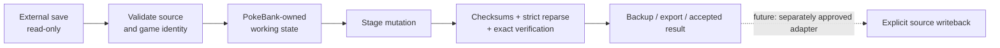

<p align="center">
  
</p>

<h1 align="center">PokeBank NX</h1>

<p align="center">
  <strong>A native, offline Pokémon bank and save-management frontend for CFW Nintendo Switch systems.</strong>
</p>

<p align="center">
  Browse supported saves, inspect Trainers / Party / Boxes / inventory, stage generation-aware Pokémon edits,
  and move toward one safe library for Pokémon across generations.
</p>

<p align="center">
  <a href="LICENSE"></a>
  
  
  
  
</p>

<p align="center">
  <a href="https://github.com/GlitchedZeus/PokeBank-NX/actions/workflows/host-tests.yml"></a>
  <a href="https://github.com/GlitchedZeus/PokeBank-NX/pull/307"></a>
  <a href="https://github.com/GlitchedZeus/PokeBank-NX/pull/314"></a>
</p>

<p align="center">
  <a href="#overview">Overview</a> •
  <a href="#project-status">Status</a> •
  <a href="#features">Features</a> •
  <a href="#supported-games">Games</a> •
  <a href="#save-safety">Safety</a> •
  <a href="#building">Build</a> •
  <a href="#roadmap">Roadmap</a> •
  <a href="#license">License</a>
</p>

---

> [!IMPORTANT]
> **Active alpha — no v1.0 release.** The current milestone is **Gen V finalization on the same Gen I–V shared editor**, followed by an independent audit of **every reachable action in all 20 Gen I–V games** and a full [Switch hardware test](docs/handoffs/GEN15_HARDWARE_ACCEPTANCE_GATE_20261015.md). Gen VI/new-emulator application integration waits until the owner explicitly accepts one exact NRO. The active [app PR #307](https://github.com/GlitchedZeus/PokeBank-NX/pull/307) is at `8529557e` (latest CI still running); the last verified nine-check-green [Gen I–V NRO](https://github.com/GlitchedZeus/PokeBank-NX/actions/runs/38688539838) is `2af25639`, **not hardware accepted**. The earlier `fa9cfcea` candidate **failed an actual Switch test** and requires retesting. [Legality #314](https://github.com/GlitchedZeus/PokeBank-NX/pull/314) continues independently; historical PKHeX completeness is not yet claimed.

## Overview

PokeBank NX brings Pokémon save management to the Nintendo Switch with a consistent interface for older generations. Choose a game, find its save, browse the Trainer, Party, Boxes and inventory, and make changes in a staged workspace rather than editing the original file in place.

The project started with the classic Game Sources workflow and has grown into a HOME-inspired frontend with game artwork, trainer context, Party previews, source assignment and a shared editor. Underneath that interface, each generation keeps its own save structure, limits and history. A Gen I Pokémon should feel like a Gen I Pokémon—not a modern record with invented fields.

Current work centers on **one combined Gen I–V application NRO**, full source/profile/editor parity for Black/White/Black 2/White 2, and a separately coordinated **Gen I–V read-only legality engine**. Master Vault, named Banks, later-generation emulator integration and direct original-save writeback remain future milestones.

### Design goals

- **Built for the Switch** — readable handheld UI, controller and touch interaction, useful game artwork and quick access to saves.
- **Respect the games** — generation-specific values, move restrictions and source rules, without silent conversions.
- **Keep saves safe** — external sources stay untouched during normal browsing and staged editing.
- **Make uncertainty visible** — a missing source, uncertain history or unsupported rule is reported, not guessed.
- **Prove each build** — passing automation matters, but a hardware claim belongs to the exact NRO that was tested.

## Project status

**Checked against live GitHub October 15, 2026.** ✅ previously accepted foundation; 🧪 implemented in an unmerged draft with software evidence; 🔬 isolated research; ⏳ future. Physical Switch approval is a **separate gate**.

| Area | Current implementation / development | Remaining |
|---|---|---|
| Native Switch app | ✅ C++20/devkitA64, one shared editor, NRO/RomFS builds, host and sanitizer regression infrastructure | Owner accepts one exact all-green NRO |
| Gen I — Red/Blue/Yellow | ✅ Earlier hardware-accepted native staged editor | Full three-game combined regression |
| Gen II — Gold/Silver/Crystal | ✅ Earlier accepted DV/Stat Exp/Pokérus/Items/editor foundation | Full three-game regression and export safety |
| Gen III — R/S/E/FR/LG | ✅ Earlier accepted Trainer/Party/Boxes/Items editor | Full five-game regression and RetroArch exit/return fix |
| Gen IV — D/P/Pt/HG/SS | ✅ Earlier shared-editor milestone; finalization history incorporated into [#307](https://github.com/GlitchedZeus/PokeBank-NX/pull/307) | Five-game DraStic/melonDS/Items/launch-return retest |
| Gen V — B/W/B2/W2 | 🧪 [#307](https://github.com/GlitchedZeus/PokeBank-NX/pull/307): strict exact-copy sources, shared PK5 Edit/Create/Move, Trainer, Bag, read-only Pokédex, Review, app-owned verified export | Four-title hardware retest of hub, encrypted blank Create, new-game trainer, emulator source and touch |
| Home, Games and sources | 🧪 Current-save Home snapshots and actual provider labels via [#315](https://github.com/GlitchedZeus/PokeBank-NX/pull/315), incorporated into #307 | Hardware confirmation of covers, Trainer/Party, save assignment and source refresh |
| Combined Gen I–V NRO | 🧪 [#307](https://github.com/GlitchedZeus/PokeBank-NX/pull/307) at `8529557e` has current checks still in progress; last 9/9-green software candidate `2af25639` | **Not device accepted.** [All-20-game, every-action gate #313](https://github.com/GlitchedZeus/PokeBank-NX/issues/313) |
| Gen I–V legality | 🔬 [#314](https://github.com/GlitchedZeus/PokeBank-NX/pull/314) consolidates five Gen I–IV evidence lanes, fixes and emerging Gen V PKHeX differential work | 3 failing and 0 running checks at the observed head; evidence/coverage review |
| Independent QA | 🧪 [#310](https://github.com/GlitchedZeus/PokeBank-NX/pull/310): parsing fuzz, export contracts and NRO auditing | Resolve outstanding historical CI/workflow and Gen II export-publish findings |
| Gen VI–VIII | 🔬 Standalone native-format research [#309](https://github.com/GlitchedZeus/PokeBank-NX/pull/309), [#311](https://github.com/GlitchedZeus/PokeBank-NX/pull/311), [#312](https://github.com/GlitchedZeus/PokeBank-NX/pull/312) | **On hold for app integration** until Gen I–V passes on real Switch |
| Vault/Banks, future transfers | ⏳ [Deferred backlog](docs/FUTURE_AFTER_GEN15_BACKLOG.md) | Later milestones with separate source-safety reviews |

> [!NOTE]
> **Last earlier owner-accepted integrated build:** `0760334fb850ca46b5171c55f690998d7680d4e7` (Oct 8), NRO SHA-256 `4f28d7f7ad38c2b62458642e014ae3c05e866755c4152bf4c2db0574c381ce91`. **Last fully green Gen I–V development NRO:** [`2af25639`](https://github.com/GlitchedZeus/PokeBank-NX/actions/runs/38688539838); it still needs your Switch approval. Draft code is not merged into default `main`.

## Features

### Product Home

The main screen is built around the game you're using. Trainer details, the current Party, Pokédex progress and the selected save sit alongside clear **Open** and **Launch** actions.

- Game and region artwork, trainer portraits and a six-Pokémon Party preview.
- Full Games artwork browser plus a quicker Games drawer.
- Game/save/profile assignment instead of treating every similarly named file as the same source.
- Real per-save Pokédex progress where available.
- Games, Banks, Items, Search and More navigation; planned destinations are marked as such.
- Settings and profiles kept out of the main card layout.
- Shared in-app keyboard and numpad, controller navigation and focus memory.
- Sorting, Release Date ordering, Favorites and multiple visual themes.

The integrated Product Home and legacy launch paths have an owner-tested checkpoint. Later UI refinements are still under review; the layout shown in a draft branch may not match the last accepted NRO.

### Games and save sources

The Games screen is also where a save gets assigned to its game. You can inspect supported source options, reassign a validated legacy save, and see when PokeBank NX cannot determine a unique match.

Source identity remains separate from launch identity. For example, a FireRed HOME forwarder can be a launch target without becoming the source of the GBA battery save. Ambiguous game versions, duplicate save paths and unverified ROM locations are not silently resolved.

### Pokémon and inventory

One **generation-aware shared Pokémon editor** serves Generations I–V. It respects native fields and saves staged edits in app-owned memory rather than mutating emulator sources.

- **Gen I–III:** previously accepted Party/Boxes/Trainer/Items, native DV/Stat Exp/ability rules where applicable, shared View/Create/Edit and safe cancellation.
- **Gen IV:** shared Party/Box Edit/Create, native species/form/moves/PP and Items; updated touch, source discovery and launch identity on the Gen I–V integration branch.
- **Gen V:** Black/White/Black 2/White 2 native PK5, Trainer/Party/24 Boxes, Create/Clone/Move, Bag pockets, Trainer Name/Money/Play Time staging, seen/caught Pokédex (read-only), Review and strictly verified **Export Copy** ([#307](https://github.com/GlitchedZeus/PokeBank-NX/pull/307)).
- **Profiles and current saves:** exact **Assign Save to This Profile**, selectable validated primary/backup copy, provider labels and Home cards refreshed from the assigned source. RetroArch, DraStic, melonDS and manual linking are separate source choices.
- **Ongoing shared UI polish:** conditional actions, confirmation-safe Remove/Move/Discard, touch parity, sprite/shiny presentation in species pickers and Move accuracy/power/PP parity.

Earlier application PRs [#278](https://github.com/GlitchedZeus/PokeBank-NX/pull/278), [#300](https://github.com/GlitchedZeus/PokeBank-NX/pull/300), [#304](https://github.com/GlitchedZeus/PokeBank-NX/pull/304) and [#306](https://github.com/GlitchedZeus/PokeBank-NX/pull/306) were closed as **superseded** after their heads were verified inside #307. Their commits were preserved; this did **not** merge them into `main` or authorize hardware acceptance.

## Supported games

| Generation | Games | Save/source | Shared staged editor | Hardware |
|---|---|:---:|:---:|---|
| I | Red / Blue / Yellow | ✅ | ✅ | Earlier acceptance; combined retest |
| II | Gold / Silver / Crystal | ✅ | ✅ | Earlier acceptance; combined retest |
| III | Ruby / Sapphire / Emerald / FireRed / LeafGreen | ✅ | ✅ | Earlier acceptance; combined retest |
| IV | Diamond / Pearl / Platinum / HeartGold / SoulSilver | ✅ | ✅ | Earlier milestone; full retest |
| V | Black / White / Black 2 / White 2 | 🧪 | 🧪 | **Device acceptance pending** |
| VI | X / Y / Omega Ruby / Alpha Sapphire | 🔬 | 🔬 standalone backend only | On hold for app integration |
| VII | Sun / Moon / Ultra Sun / Ultra Moon | 🔬 | ❌ integrated editor | On hold; read-only SAV7 groundwork |
| VIII | Sword / Shield | 🔬 | ❌ integrated editor | On hold; read-only PK8 groundwork |
| Later modern Switch | LGPE, BDSP, PLA, SV, Legends: Z-A | ⏳ | ❌ general editor | Future |

All **20 Gen I–V game releases** require their own hardware smoke and applicable action coverage. A game card or experimental parser does not imply a hardware-accepted save editor.

## Save sources and launching

PokeBank NX treats each discovered save as a **game + provider + source identity**. A title can have more than one candidate save, and a save's location is not proof of where its ROM or forwarder lives.

The current implementation includes:

- RetroArch legacy source discovery and tested GB/GBC/GBA launch paths.
- DraStic and melonDS Gen IV source support, with provider-neutral assignment.
- Gen V RetroArch/DraStic/melonDS/manual **Save Instances**, exact BW/B2W2 matching, explicit Primary/Backup choice, **Assign Save to This Profile** and strict reopen fingerprint checks ([#307](https://github.com/GlitchedZeus/PokeBank-NX/pull/307)); device acceptance remains pending.
- Manual and remembered source selection, duplicate detection, explicit source details and real provider labels; assigned-save Home snapshots are revalidated when source metadata changes.
- Game-file links, bounded content discovery and exact-release matching for launch targets.
- Matching installed HOME-forwarder launch preference where the title is proven.
- A safe **Link Game File** fallback when the launch target cannot be identified.

The tested `0760334f` NRO includes working legacy RetroArch launches, Nintendo DS direct launch (Diamond was tested) and owner-confirmed **Quit & Return**. An experimental nested Return Host caused regressions and was excluded from that accepted route.

Gen I–III provider-specific bounded discovery already has mGBA and Tico groundwork in its development lineage. Cross-generation provider completeness and Switch acceptance vary; generalized 3DS and additional emulator adapters remain roadmap work.

> [!WARNING]
> A save path is **not** a ROM path. Launch access never grants write access to that save, and the app should ask for a source or game-file link rather than guess.

## Save safety

The save-safety contract is intentionally boring — and that is the point.



### Permanent guardrails

- ✅ Original external saves remain immutable during ordinary editing.
- ✅ Emulator-source writes remain disabled.
- ✅ Installed-title live writes remain disabled.
- ✅ Unknown or ambiguous sources fail closed.
- ✅ App-owned staged editing is allowed.
- ✅ Destructive operations require explicit intent.
- ✅ Launch capability and write capability are separate permissions.
- ❌ No global unsafe-write toggle.
- ❌ Source injection is not enabled as a side effect of editor work.
- ❌ Cross-game True Move is not broadly enabled.

The intended future transaction model is:

**fingerprint → backup → stage → validate → explicit write → readback → recovery/rollback**

Every source adapter must earn write permission independently.

## Read-only legality engine

**Active Gen I–V integration: [legality campaign PR #314](https://github.com/GlitchedZeus/PokeBank-NX/pull/314)** at `cda2b70f` (October 15). Claude has brought together the original Gen I–IV five-lane coordinator, earlier [#303](https://github.com/GlitchedZeus/PokeBank-NX/pull/303)/[#308](https://github.com/GlitchedZeus/PokeBank-NX/pull/308) safety and source findings, and has started Gen V-specific PKHeX differential coverage. The combined source/host checks are **not all passing**, and historical PKHeX parity is **not complete**.

The native [Gen I–IV read-only foundation #103](https://github.com/GlitchedZeus/PokeBank-NX/pull/103) evaluates only source-game and generation-specific rules supported by evidence. The independent research is now being reconciled:

| Area | Specialist lane | Evidence |
|---|---|---|
| Encounters / RNG | [L1 #293](https://github.com/GlitchedZeus/PokeBank-NX/pull/293) | Original wild, fishing, static, game-specific encounter slots and RNG histories |
| Breeding / eggs | [L2 #295](https://github.com/GlitchedZeus/PokeBank-NX/pull/295) | Egg, inherited move/IV and native PID chronology |
| Moves / transfers | [L3 #296](https://github.com/GlitchedZeus/PokeBank-NX/pull/296) | Joint four-move histories, TM/HM, Time Capsule and Pal Park |
| Events / native metadata | [L4 #292](https://github.com/GlitchedZeus/PokeBank-NX/pull/292) | Authenticated original distribution, event context, Balls/ribbons/Trainer data |
| Research and QA | [L5 #294](https://github.com/GlitchedZeus/PokeBank-NX/pull/294) | Pinned originals, independent positive/negative/Unknown tests, PKHeX differentials |

| Result | Meaning |
|---|---|
| **Invalid** | Source-backed applicable evidence establishes a contradiction |
| **No problems found** | The implemented checks found no issue; not a global legality certificate |
| **Incomplete / Unknown** | Missing original history, unsupported mechanics or insufficient evidence |

The important distinction is between a **possible candidate history** and proof of an actual trainer's encounter, trade, TM use or event. Gen I has no native abilities, natures, gender or breeding fields; unsupported history must never be invented to complete a report.

> [!CAUTION]
> Legality analysis remains strictly **read-only**. It does not fix Pokémon, mutate external source saves, enable cross-game True Move, or certify unverified original distributions. The final Gen I–V legality scope must be backed by source evidence, passing exact-head tests and independently reviewed Unknown handling.

[Current legality campaign #314](https://github.com/GlitchedZeus/PokeBank-NX/pull/314) · [original Gen I acceptance ledger](docs/legality/GEN1_RBY_ACCEPTANCE_LEDGER_20261013.md) · [later-format foundation #301](https://github.com/GlitchedZeus/PokeBank-NX/pull/301).

## Engineering quality

PokeBank NX is checked at more than one level:

- Host regressions covering save parsing, editor rules, UI contracts and source custody.
- ASan/UBSan runs and malformed-save quarantine tests.
- Generated data, art/asset and native packaging checks.
- Clean devkitA64/libnx builds and NRO artifacts for exact commits.
- Focused Gen I–IV editor, source-opening, move and save-recovery tests.
- Physical Switch testing against an exact NRO, not just a passing branch.

The full repository forensic audit was completed, and the remediation was integrated into the active application branch in [PR #101](https://github.com/GlitchedZeus/PokeBank-NX/pull/101): **43 verified/fixed findings, one explicitly deferred, none left open in that audit ledger**. The deferred trainer-name presentation case still needs a real failing disposable Gen IV save; it is not being hidden by fabricating a name.

The five legality lanes also produce standalone native and source-research tests. Some of those tests still need to be registered in the shared host build and rerun on a reconciled exact commit; existing green CI alone does **not** certify tests that were not executed.

<details>
<summary><strong>Active engineering branches and checkpoints</strong></summary>

| Branch / PR | Current purpose and gate |
|---|---|
| [#307 — combined Gen I–V app](https://github.com/GlitchedZeus/PokeBank-NX/pull/307) | Current `8529557e`; last nine-check-green `2af25639`; **no current combined hardware sign-off** |
| [#315 — current-save Home snapshots](https://github.com/GlitchedZeus/PokeBank-NX/pull/315) | Merged forward into #307; refreshes assigned save and real source/provider labels |
| [#310 — independent QA](https://github.com/GlitchedZeus/PokeBank-NX/pull/310) | Fuzz, verified export, NRO integrity and known remaining cleanup findings |
| [#314 — Gen I–V legality campaign](https://github.com/GlitchedZeus/PokeBank-NX/pull/314) | Current `cda2b70f`; source-backed integration and Gen V differential work, 3 failed checks under review |
| [#298/#303, L1–L5 — legality source lineage](https://github.com/GlitchedZeus/PokeBank-NX/issues/285) | Original research and test evidence preserved until incorporated with verified ancestry |
| [#309/#311/#312 — future generations](https://github.com/GlitchedZeus/PokeBank-NX/pull/309) | Gen VI–VIII separate native-format research; no new emulator app integration before Gen I–V approval |
| [#278/#300/#304/#306 — older application PRs](https://github.com/GlitchedZeus/PokeBank-NX/blob/main/docs/GITHUB_CLEANUP_20261015.md) | Closed as superseded by #307 with their histories retained; not merged into `main` |

**Target repository structure after acceptance:** `main`, one Gen VI+ application development branch and one legality development branch. Historical fixtures, licensing evidence and hardware-tested binaries remain archived.

</details>

## Building

PokeBank NX targets Nintendo Switch homebrew using **C++20**, **devkitPro / devkitA64 / libnx**, **SDL2** for platform/window/input support, and **NanoVG/OpenGL** for the current renderer.

### Requirements

- devkitPro;
- devkitA64;
- libnx;
- GNU Make;
- a CFW Nintendo Switch / homebrew environment for device testing.

The Makefile requires `DEVKITPRO` to be set in the environment.

```bash
git clone https://github.com/GlitchedZeus/PokeBank-NX.git
cd PokeBank-NX
make
```

The native target is `PokeBankNX.nro`.

> [!NOTE]
> There is no v1.0 release yet. For development/hardware candidates, GitHub Actions is the reproducible build path used by the project. Hardware acceptance is tied to the exact application commit and exact built NRO, not merely to a nearby green commit.

## Installation

For a locally built/development NRO:

1. Create a folder such as `sdmc:/switch/PokeBank-NX/`.
2. Copy `PokeBankNX.nro` into that folder.
3. Launch it from the Switch homebrew menu.
4. Keep your real saves backed up and treat development builds as development builds.

PokeBank NX does not provide commercial game ROMs or console firmware.

## Repository layout

| Path | Purpose |
|---|---|
| `src/` | Application, UI, save, Pokémon, conversion, legality and integration code |
| `include/` | Public/internal interfaces and shared models |
| `romfs/` | Runtime presentation/data assets packaged into the NRO |
| `assets/` | Application metadata/icon resources |
| `tests/` | Host regression and safety-contract tests |
| `tools/` | Data generation, asset preparation and maintenance utilities |
| `.github/workflows/` | Host, sanitizer and native Switch CI |
| `docs/` | Engineering status, support matrices, architecture and roadmap documentation |

## Roadmap

**Finish Gen V → audit and test all Gen I–V → owner approves exact NRO → begin Gen VI/new-emulator work.** Legality continues in parallel as its own reviewed branch.

1. **Complete Gen V:** [#307](https://github.com/GlitchedZeus/PokeBank-NX/pull/307) must close the actual earlier Switch failures (hub, encrypted blank slot/Create and neutral new-game Trainer), finish shared picker/artwork/move-detail parity, source/provider linking, Trainer/Bag/Pokédex and safe export.
2. **Finish source-backed Gen I–V legality:** [#314](https://github.com/GlitchedZeus/PokeBank-NX/pull/314) reconciles all five lanes and Gen V evidence, resolves combined CI and PKHeX/source tests, and marks unsupported histories Unknown.
3. **Audit every reachable app action:** inventory the real code paths, then expand the [106-checkpoint starter list](docs/handoffs/GEN15_HARDWARE_ACCEPTANCE_GATE_20261015.md) to include **every menu, button and touch interaction across all 20 games**.
4. **Freeze one complete NRO:** all GCC/Clang host, sanitizers, native packaging/RomFS and export/fuzz/safety gates green, then exhaustive real Switch testing and defect retests.
5. **Owner accepts the exact NRO hash:** only after this sign-off may active Gen VI/3DS emulator development proceed, using the retained Gen VI–VIII research safely.
6. **Consolidate GitHub:** work unresolved issues/PRs to genuine completion, archive unique research and artifact tags, and reach the [planned three-branch structure](docs/THREE_BRANCH_CONSOLIDATION_PLAN.md) without deleting unique commits.

[Acceptance issue #313](https://github.com/GlitchedZeus/PokeBank-NX/issues/313) · [roadmap](docs/V1_ROADMAP.md) · [historical/future backlog](docs/FUTURE_AFTER_GEN15_BACKLOG.md).

## Bug reports

Useful hardware reports include:

- PokeBank NX version / build SHA;
- exact NRO hash when available;
- Switch mode (handheld/docked);
- game and generation;
- source/provider (RetroArch, DraStic, melonDS, manual, etc.);
- exact steps to reproduce;
- screenshots or video when the issue is visual.

Please avoid posting personal/private save files publicly. Use a disposable test save when a reproduction requires writable or sensitive data.

## Project documentation

- [**Complete Gen I–V hardware acceptance matrix**](docs/handoffs/GEN15_HARDWARE_ACCEPTANCE_GATE_20261015.md) — 106 starter checks, all 20 games, expand to every reachable action.
- [**Three-branch consolidation plan**](docs/THREE_BRANCH_CONSOLIDATION_PLAN.md) — accepted `main`, future Gen VI+ branch and legality integration branch.
- [Current Engineering Status](CURRENT_STATUS.md), [Project Status](PROJECT_STATUS.md) and [Build / NRO Artifact Record](docs/BUILD_RECORD.md).
- [Game Support Matrix](docs/GAME_SUPPORT_MATRIX.md), [v1.0 Roadmap](docs/V1_ROADMAP.md) and [UI Ownership](docs/UI_OWNERSHIP_STATUS.md).
- [Gen I–V app #307](https://github.com/GlitchedZeus/PokeBank-NX/pull/307), [legality integration #314](https://github.com/GlitchedZeus/PokeBank-NX/pull/314), [independent QA #310](https://github.com/GlitchedZeus/PokeBank-NX/pull/310) and [hardware acceptance #313](https://github.com/GlitchedZeus/PokeBank-NX/issues/313).
- [GitHub housekeeping record](docs/GITHUB_CLEANUP_20261015.md), [future ideas archive](docs/FUTURE_AFTER_GEN15_BACKLOG.md) and [October 14 cross-lane snapshot](docs/ENGINEERING_SNAPSHOT_20261014.md) (historical).

**GitHub is authoritative for live development; owner device acceptance belongs to the exact tested NRO.** A successful CI run or an older accepted binary cannot certify a newer build.

## License

PokeBank NX is licensed under the **GNU Affero General Public License v3.0 (AGPL-3.0)**.

> [!NOTE]
> The complete license terms are in [LICENSE](LICENSE). The README is not a substitute for the license text.

Third-party code, data, research, artwork sources, and reference projects retain their own licenses and attribution requirements.

## Disclaimer

PokeBank NX is an unofficial fan-made homebrew project and is not affiliated with or endorsed by Nintendo, The Pokémon Company, GAME FREAK, or Creatures Inc.

Pokémon and related trademarks and game assets are property of their respective owners.
