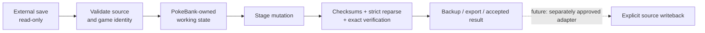

<p align="center">
  
</p>

<h1 align="center">PokeBank NX</h1>

<p align="center">
  <strong>A native, offline Pokémon bank and save-management frontend for CFW Nintendo Switch systems.</strong>
</p>

<p align="center">
  Browse supported saves, inspect Trainers / Party / Boxes / inventory, stage generation-aware Pokémon edits,
  and move toward one safe library for Pokémon across generations.
</p>

<p align="center">
  <a href="LICENSE"></a>
  
  
  
  
</p>

<p align="center">
  <a href="https://github.com/GlitchedZeus/PokeBank-NX/actions/workflows/host-tests.yml"></a>
  <a href="https://github.com/GlitchedZeus/PokeBank-NX/pull/307"></a>
  <a href="https://github.com/GlitchedZeus/PokeBank-NX/pull/314"></a>
</p>

<p align="center">
  <a href="#overview">Overview</a> •
  <a href="#project-status">Status</a> •
  <a href="#features">Features</a> •
  <a href="#supported-games">Games</a> •
  <a href="#save-safety">Safety</a> •
  <a href="#building">Build</a> •
  <a href="#roadmap">Roadmap</a> •
  <a href="#license">License</a>
</p>

---

> [!IMPORTANT]
> **Active alpha — no v1.0 release.** The current focus is **Gen I–V shared-editor polish and safe staged exports**, followed by reviewed legality integration and a full, exact-NRO Switch acceptance of **all 20 releases and every applicable action**. The owner tested [Gen I–V candidate `7fea1797`](https://github.com/GlitchedZeus/PokeBank-NX/actions/runs/38946941097/artifacts/12066747065) and reported **42/54 targeted checks passing**; six checks describe remaining problems or investigations, and six remain unverified. This is meaningful device feedback, **not full hardware acceptance** ([gate #313](https://github.com/GlitchedZeus/PokeBank-NX/issues/313)). Application [PR #307](https://github.com/GlitchedZeus/PokeBank-NX/pull/307) has advanced to `315ad61d` (later QA/application work; not this NRO's source SHA); [legality PR #314](https://github.com/GlitchedZeus/PokeBank-NX/pull/314) is independently at `cfe0e7dc`. Both are open drafts and neither has been merged into `main`. Gen VI–IX application work remains on hold until the owner approves Gen I–V.

## Overview

PokeBank NX brings Pokémon save management to the Nintendo Switch with a consistent interface for older generations. Choose a game, find its save, browse the Trainer, Party, Boxes and inventory, and make changes in a staged workspace rather than editing the original file in place.

The project started with the classic Game Sources workflow and has grown into a HOME-inspired frontend with game artwork, trainer context, Party previews, source assignment and a shared editor. Underneath that interface, each generation keeps its own save structure, limits and history. A Gen I Pokémon should feel like a Gen I Pokémon—not a modern record with invented fields.

Current work centers on **one combined Gen I–V application NRO**, full source/profile/editor parity for Black/White/Black 2/White 2, and a separately coordinated **Gen I–V read-only legality engine**. Master Vault, named Banks, later-generation emulator integration and direct original-save writeback remain future milestones.

### Design goals

- **Built for the Switch** — readable handheld UI, controller and touch interaction, useful game artwork and quick access to saves.
- **Respect the games** — generation-specific values, move restrictions and source rules, without silent conversions.
- **Keep saves safe** — external sources stay untouched during normal browsing and staged editing.
- **Make uncertainty visible** — a missing source, uncertain history or unsupported rule is reported, not guessed.
- **Prove each build** — passing automation matters, but a hardware claim belongs to the exact NRO that was tested.

## Project status

**Checked against live GitHub October 17, 2026.** ✅ previously accepted foundation / owner-observed pass; 🧪 implementation and CI in an unmerged draft; 🔬 isolated research; ⏳ future. The **42/54 targeted retest** is not the complete 20-game acceptance gate.

| Area | Current implementation / development | Remaining |
|---|---|---|
| Native Switch app | ✅ C++20/devkitA64, shared Gen I–V editor, packaged NRO/RomFS and host/sanitizer/QA gates | Finish UI/Bag/Gen V parity, exact-source export round trips and complete owner acceptance |
| Gen I — Red/Blue/Yellow | ✅ Earlier staged-editor milestone and current hardware passes for controls, moves, scrolling, layouts | Improve Bag Add-to-inventory flow and Trainer/Money editing; full three-game acceptance |
| Gen II — Gold/Silver/Crystal | ✅ Gen II Create A/B and data-pane layout among latest owner-confirmed passes | Bag Add workflow, Crystal Met Time inline behavior and complete export retests |
| Gen III — R/S/E/FR/LG | ✅ Owner-confirmed shared moves, move PP, inline Language/Pokérus, location layout and scroll | Bag Add workflow, export reopening, five-game source/launch regression |
| Gen IV — D/P/Pt/HG/SS | 🧪 Shared editor and source-specific staged export on [#307](https://github.com/GlitchedZeus/PokeBank-NX/pull/307); move panel/picker and location layout passed targeted retest | Bag workflow parity, DraStic/melonDS export/reopen, five-game exhaustive acceptance |
| Gen V — B/W/B2/W2 | 🧪 [#307](https://github.com/GlitchedZeus/PokeBank-NX/pull/307): shared PK5 Create/Edit, Party/Boxes/Trainer, Bag and staged export; Party/Boxes/Trainer display passed retest | Fix left-panel text clipping and PP/PP Ups spacing; complete Create/Review/Discard/Export and emulator round trips |
| Home, Games and sources | ✅ Latest owner retest passed A/B, L/R, two-controller input, confirmation safety and smooth scrolling; [#315](https://github.com/GlitchedZeus/PokeBank-NX/pull/315) incorporated into #307 | Full 20-release source, profile, launch/return and touch acceptance; emulator-backup management |
| Combined Gen I–V NRO | 🧪 [`7fea1797` exact candidate](https://github.com/GlitchedZeus/PokeBank-NX/actions/runs/38946941097/artifacts/12066747065), SHA-256 `217f24be…00bac1d5`, independently audited; owner-reported **42/54 targeted passes** | Six problems/investigations and six other unverified checklist items; [all-action hardware gate #313](https://github.com/GlitchedZeus/PokeBank-NX/issues/313) OPEN |
| Gen I–V legality | 🔬 [#314](https://github.com/GlitchedZeus/PokeBank-NX/pull/314) at `cfe0e7dc`: Gen I–IV production analyzer paths, Gen V engine API, Gen III/IV/V PKHeX differential suites green on latest observed head | Gen V app wiring; source-backed Colosseum/XD, historical provenance gaps, owner-reviewed integration and full rule-coverage audit |
| Independent QA | 🧪 Native/host/fuzz and exact-source NRO audit green for `7fea1797`; full Gen I–V UI candidate contracts report zero violations | Current app HEAD may have jobs running; host-only results do not replace Switch tests |
| Gen VI–VIII | 🔬 Standalone native-format research [#309](https://github.com/GlitchedZeus/PokeBank-NX/pull/309), [#311](https://github.com/GlitchedZeus/PokeBank-NX/pull/311), [#312](https://github.com/GlitchedZeus/PokeBank-NX/pull/312) | **Application integration paused** until Gen I–V approval; Gen IX remains future scope |
| Vault/Banks, future transfers | ⏳ [Deferred backlog](docs/FUTURE_AFTER_GEN15_BACKLOG.md), UI entry points are not a persistent Vault | Future milestones with separate safety and storage reviews |

> [!NOTE]
> **Targeted Switch retest:** the owner reported **42 passes out of 54 checks** on `PokeBank-NX-Gen1-5-Candidate-7fea1797.nro` (code `7fea17971906cae557a7207bfb7b0bed3548cea2`; NRO SHA-256 `217f24becaaa4eb940abaef01962c80a2fb5536bc6af77934add92d900bac1d5`). Confirmed passes include controls, Gen II Create, moves/PP, many modal/layout changes, scrolling, Gen V Party/Boxes/Trainer display and original-save immutability. The owner did **not** provide a full game/provider matrix or emulator round-trip validation. The active source head is newer, but this exact file remains the reported hardware-test baseline. [Candidate retest script](https://github.com/GlitchedZeus/PokeBank-NX/blob/8587f20bbfe9c984f6b2165da38c8da5bb34926e/docs/hardware/RETEST_7fea1797.md).

## Features

### Product Home

The main screen is built around the game you're using. Trainer details, the current Party, Pokédex progress and the selected save sit alongside clear **Open** and **Launch** actions.

- Game and region artwork, trainer portraits and a six-Pokémon Party preview.
- Full Games artwork browser plus a quicker Games drawer.
- Game/save/profile assignment instead of treating every similarly named file as the same source.
- Real per-save Pokédex progress where available.
- Games, Banks, Items, Search and More navigation; planned destinations are marked as such.
- Settings and profiles kept out of the main card layout.
- Shared in-app keyboard and numpad, controller navigation and focus memory.
- Sorting, Release Date ordering, Favorites and multiple visual themes.

The integrated Product Home and legacy launch paths have an owner-tested checkpoint. Later UI refinements are still under review; the layout shown in a draft branch may not match the last accepted NRO.

### Games and save sources

The Games screen is also where a save gets assigned to its game. You can inspect supported source options, reassign a validated legacy save, and see when PokeBank NX cannot determine a unique match.

Source identity remains separate from launch identity. For example, a FireRed HOME forwarder can be a launch target without becoming the source of the GBA battery save. Ambiguous game versions, duplicate save paths and unverified ROM locations are not silently resolved.

### Pokémon and inventory

One **generation-aware shared Pokémon editor** serves Generations I–V. It respects native fields and saves staged edits in app-owned memory rather than mutating emulator sources.

- **Gen I–III:** previously accepted Party/Boxes/Trainer/Items, native DV/Stat Exp/ability rules where applicable, shared View/Create/Edit and safe cancellation.
- **Gen IV:** shared Party/Box Edit/Create, native species/form/moves/PP and Items; updated touch, source discovery and launch identity on the Gen I–V integration branch.
- **Gen V:** Black/White/Black 2/White 2 native PK5, Trainer/Party/24 Boxes, Create/Clone/Move, Bag pockets, Trainer Name/Money/Play Time staging, seen/caught Pokédex (read-only), Review and strictly verified **Export Copy** ([#307](https://github.com/GlitchedZeus/PokeBank-NX/pull/307)).
- **Profiles and current saves:** exact **Assign Save to This Profile**, selectable validated primary/backup copy, provider labels and Home cards refreshed from the assigned source. RetroArch, DraStic, melonDS and manual linking are separate source choices.
- **Owner-tested Gen I–V polish:** shared four-slot Moves/PP panels and chooser; inline Pokérus, Shiny and supported Language; consistent Actions, footers, modal safeguards and navigation repeat. These passed relevant targeted Switch checks on `7fea1797`.
- **Active repair round:** Bag Add should insert quantity 1 before stack editing, compact modal geometry, incremental species search, draggable scrollbar thumbs, Gen I Trainer/Money staging, Crystal Met Time inline editing, and Gen V field clipping/PP caption/review parity. Proposed improvements are **not** claimed to be in the tested candidate.

Earlier application PRs [#278](https://github.com/GlitchedZeus/PokeBank-NX/pull/278), [#300](https://github.com/GlitchedZeus/PokeBank-NX/pull/300), [#304](https://github.com/GlitchedZeus/PokeBank-NX/pull/304) and [#306](https://github.com/GlitchedZeus/PokeBank-NX/pull/306) were closed as **superseded** after their heads were verified inside #307. Their commits were preserved; this did **not** merge them into `main` or authorize hardware acceptance.

## Supported games

| Generation | Games | Save/source | Shared staged editor | Hardware |
|---|---|:---:|:---:|---|
| I | Red / Blue / Yellow | ✅ | ✅ | Earlier acceptance; combined retest |
| II | Gold / Silver / Crystal | ✅ | ✅ | Earlier acceptance; combined retest |
| III | Ruby / Sapphire / Emerald / FireRed / LeafGreen | ✅ | ✅ | Earlier acceptance; combined retest |
| IV | Diamond / Pearl / Platinum / HeartGold / SoulSilver | ✅ | ✅ | Earlier milestone; full retest |
| V | Black / White / Black 2 / White 2 | 🧪 | 🧪 | **Device acceptance pending** |
| VI | X / Y / Omega Ruby / Alpha Sapphire | 🔬 | 🔬 standalone backend only | On hold for app integration |
| VII | Sun / Moon / Ultra Sun / Ultra Moon | 🔬 | ❌ integrated editor | On hold; read-only SAV7 groundwork |
| VIII | Sword / Shield | 🔬 | ❌ integrated editor | On hold; read-only PK8 groundwork |
| Later modern Switch | LGPE, BDSP, PLA, SV, Legends: Z-A | ⏳ | ❌ general editor | Future |

All **20 Gen I–V game releases** require their own hardware smoke and applicable action coverage. A game card or experimental parser does not imply a hardware-accepted save editor.

## Save sources and launching

PokeBank NX treats each discovered save as a **game + provider + source identity**. A title can have more than one candidate save, and a save's location is not proof of where its ROM or forwarder lives.

The current implementation includes:

- RetroArch legacy source discovery and tested GB/GBC/GBA launch paths.
- DraStic and melonDS Gen IV source support, with provider-neutral assignment.
- Gen V RetroArch/DraStic/melonDS/manual **Save Instances**, exact BW/B2W2 matching, explicit Primary/Backup choice, **Assign Save to This Profile** and strict reopen fingerprint checks ([#307](https://github.com/GlitchedZeus/PokeBank-NX/pull/307)); device acceptance remains pending.
- Manual and remembered source selection, duplicate detection, explicit source details and real provider labels; assigned-save Home snapshots are revalidated when source metadata changes.
- Game-file links, bounded content discovery and exact-release matching for launch targets.
- Matching installed HOME-forwarder launch preference where the title is proven.
- A safe **Link Game File** fallback when the launch target cannot be identified.

The tested `0760334f` NRO includes working legacy RetroArch launches, Nintendo DS direct launch (Diamond was tested) and owner-confirmed **Quit & Return**. An experimental nested Return Host caused regressions and was excluded from that accepted route.

Gen I–III provider-specific bounded discovery already has mGBA and Tico groundwork in its development lineage. Cross-generation provider completeness and Switch acceptance vary; generalized 3DS and additional emulator adapters remain roadmap work.

> [!WARNING]
> A save path is **not** a ROM path. Launch access never grants write access to that save, and the app should ask for a source or game-file link rather than guess.

## Save safety

The save-safety contract is intentionally boring — and that is the point.



### Permanent guardrails

- ✅ Original external saves remain immutable during ordinary editing.
- ✅ Emulator-source writes remain disabled.
- ✅ Installed-title live writes remain disabled.
- ✅ Unknown or ambiguous sources fail closed.
- ✅ App-owned staged editing is allowed.
- ✅ Destructive operations require explicit intent.
- ✅ Launch capability and write capability are separate permissions.
- ❌ No global unsafe-write toggle.
- ❌ Source injection is not enabled as a side effect of editor work.
- ❌ Cross-game True Move is not broadly enabled.

The intended future transaction model is:

**fingerprint → backup → stage → validate → explicit write → readback → recovery/rollback**

Every source adapter must earn write permission independently.

## Read-only legality engine

**Active Gen I–V legality campaign: [PR #314](https://github.com/GlitchedZeus/PokeBank-NX/pull/314)** at `cfe0e7dcebfb195c15f16510595377da11543545` (October 16). Its latest observed **10 exact-head legality CI workflows passed**. Gen I–IV analysis is production-wired on that legality branch; Gen V has an engine API and differential tests but is **not yet connected to the active application's PK5 views**. The engine remains a separate, unmerged draft. Historical and GameCube provenance gaps remain, so complete PKHeX parity is **not** claimed.

The native [Gen I–IV read-only foundation #103](https://github.com/GlitchedZeus/PokeBank-NX/pull/103) and the five specialist lanes feed the integrated PK1–PK5 campaign. Its differential results are **test-corpus measurements**, not a universal percent of all historical Pokémon: Gen III catches 43,110/43,120 invalid mutations (99.98%); Gen IV 83,599/83,599 base and 113,993/113,993 grown (100% of those corpora); Gen V 231,941/233,840 (99.2%). No false Valid/Invalid errors were reported under the published corpus criteria. Colosseum/XD transfer provenance, selected Gen II Korean/history cases and other missing evidence remain **Incomplete**. [Rule coverage and production wiring](https://github.com/GlitchedZeus/PokeBank-NX/blob/claude/gen1-5-legality-campaign-w9mkom/docs/legality/GEN1_5_RULE_COVERAGE.md). The specialist lanes are:

| Area | Specialist lane | Evidence |
|---|---|---|
| Encounters / RNG | [L1 #293](https://github.com/GlitchedZeus/PokeBank-NX/pull/293) | Original wild, fishing, static, game-specific encounter slots and RNG histories |
| Breeding / eggs | [L2 #295](https://github.com/GlitchedZeus/PokeBank-NX/pull/295) | Egg, inherited move/IV and native PID chronology |
| Moves / transfers | [L3 #296](https://github.com/GlitchedZeus/PokeBank-NX/pull/296) | Joint four-move histories, TM/HM, Time Capsule and Pal Park |
| Events / native metadata | [L4 #292](https://github.com/GlitchedZeus/PokeBank-NX/pull/292) | Authenticated original distribution, event context, Balls/ribbons/Trainer data |
| Research and QA | [L5 #294](https://github.com/GlitchedZeus/PokeBank-NX/pull/294) | Pinned originals, independent positive/negative/Unknown tests, PKHeX differentials |

| Result | Meaning |
|---|---|
| **Invalid** | Source-backed applicable evidence establishes a contradiction |
| **No problems found** | The implemented checks found no issue; not a global legality certificate |
| **Incomplete / Unknown** | Missing original history, unsupported mechanics or insufficient evidence |

The important distinction is between a **possible candidate history** and proof of an actual trainer's encounter, trade, TM use or event. Gen I has no native abilities, natures, gender or breeding fields; unsupported history must never be invented to complete a report.

> [!CAUTION]
> Legality analysis remains strictly **read-only**. It does not fix Pokémon, mutate external source saves, enable cross-game True Move, or certify unverified original distributions. The final Gen I–V legality scope must be backed by source evidence, passing exact-head tests and independently reviewed Unknown handling.

[Current legality campaign #314](https://github.com/GlitchedZeus/PokeBank-NX/pull/314) · [original Gen I acceptance ledger](docs/legality/GEN1_RBY_ACCEPTANCE_LEDGER_20261013.md) · [later-format foundation #301](https://github.com/GlitchedZeus/PokeBank-NX/pull/301).

## Engineering quality

PokeBank NX is checked at more than one level:

- Host regressions covering save parsing, editor rules, UI contracts and source custody.
- ASan/UBSan runs and malformed-save quarantine tests.
- Generated data, art/asset and native packaging checks.
- Clean devkitA64/libnx builds and NRO artifacts for exact commits.
- Focused Gen I–IV editor, source-opening, move and save-recovery tests.
- Physical Switch testing against an exact NRO, not just a passing branch.

The full repository forensic audit was completed, and the remediation was integrated into the active application branch in [PR #101](https://github.com/GlitchedZeus/PokeBank-NX/pull/101): **43 verified/fixed findings, one explicitly deferred, none left open in that audit ledger**. The deferred trainer-name presentation case still needs a real failing disposable Gen IV save; it is not being hidden by fabricating a name.

The legality campaign now runs dedicated PKHeX differential, native, sanitizer, original-source and cross-lane gates; the latest observed legality head had 10 successful CI workflows. The application's newer candidate also passed an independent exact-binary audit. These do **not** replace owner Switch validation or prove universally complete historical rule coverage.

<details>
<summary><strong>Active engineering branches and checkpoints</strong></summary>

| Branch / PR | Current purpose and gate |
|---|---|
| [#307 — combined Gen I–V app](https://github.com/GlitchedZeus/PokeBank-NX/pull/307) | Current `315ad61d` (development); `7fea1797` targeted retest **42/54 passed**, full 20-game sign-off OPEN |
| [#315 — current-save Home snapshots](https://github.com/GlitchedZeus/PokeBank-NX/pull/315) | Merged forward into #307; refreshes assigned save and real source/provider labels |
| [#310 — independent QA](https://github.com/GlitchedZeus/PokeBank-NX/pull/310) | Closed/superseded QA PR; fuzz/export/NRO-audit work and subsequent contracts integrated into #307 |
| [#314 — Gen I–V legality campaign](https://github.com/GlitchedZeus/PokeBank-NX/pull/314) | Current `cfe0e7dc`; latest observed legality CI green; GameCube/historical gaps and reviewed app merge pending |
| [#298/#303, L1–L5 — legality source lineage](https://github.com/GlitchedZeus/PokeBank-NX/issues/285) | Original research and test evidence preserved until incorporated with verified ancestry |
| [#309/#311/#312 — future generations](https://github.com/GlitchedZeus/PokeBank-NX/pull/309) | Gen VI–VIII separate native-format research; no new emulator app integration before Gen I–V approval |
| [#278/#300/#304/#306 — older application PRs](https://github.com/GlitchedZeus/PokeBank-NX/blob/main/docs/GITHUB_CLEANUP_20261015.md) | Closed as superseded by #307 with their histories retained; not merged into `main` |

**Target repository structure after acceptance:** `main`, one Gen VI+ application development branch and one legality development branch. Historical fixtures, licensing evidence and hardware-tested binaries remain archived.

</details>

## Building

PokeBank NX targets Nintendo Switch homebrew using **C++20**, **devkitPro / devkitA64 / libnx**, **SDL2** for platform/window/input support, and **NanoVG/OpenGL** for the current renderer.

### Requirements

- devkitPro;
- devkitA64;
- libnx;
- GNU Make;
- a CFW Nintendo Switch / homebrew environment for device testing.

The Makefile requires `DEVKITPRO` to be set in the environment.

```bash
git clone https://github.com/GlitchedZeus/PokeBank-NX.git
cd PokeBank-NX
make
```

The native target is `PokeBankNX.nro`.

> [!NOTE]
> There is no v1.0 release yet. For development/hardware candidates, GitHub Actions is the reproducible build path used by the project. Hardware acceptance is tied to the exact application commit and exact built NRO, not merely to a nearby green commit.

## Installation

For a locally built/development NRO:

1. Create a folder such as `sdmc:/switch/PokeBank-NX/`.
2. Copy `PokeBankNX.nro` into that folder.
3. Launch it from the Switch homebrew menu.
4. Keep your real saves backed up and treat development builds as development builds.

PokeBank NX does not provide commercial game ROMs or console firmware.

## Repository layout

| Path | Purpose |
|---|---|
| `src/` | Application, UI, save, Pokémon, conversion, legality and integration code |
| `include/` | Public/internal interfaces and shared models |
| `romfs/` | Runtime presentation/data assets packaged into the NRO |
| `assets/` | Application metadata/icon resources |
| `tests/` | Host regression and safety-contract tests |
| `tools/` | Data generation, asset preparation and maintenance utilities |
| `.github/workflows/` | Host, sanitizer and native Switch CI |
| `docs/` | Engineering status, support matrices, architecture and roadmap documentation |

## Roadmap

**Complete the current Gen I–V UI/Bag/Trainer/Gen V repair rounds → owner retests one exact candidate → reviewed legality integration → combined Gen I–V hardware and safety acceptance → then Gen VI–IX.** The [42/54 targeted retest](https://github.com/GlitchedZeus/PokeBank-NX/actions/runs/38946941097/artifacts/12066747065) is a progress checkpoint, **not** the complete acceptance matrix.

1. **Shared UI and missing functionality:** [#307](https://github.com/GlitchedZeus/PokeBank-NX/pull/307) is implementing Bag Add/quantity parity, compact pickers, live species search, touch scrollbar dragging, Gen I Trainer editing, Crystal Met Time and Gen V layout/review/export parity. Retain the 42 owner-confirmed passes.
2. **Legality completion:** [#314](https://github.com/GlitchedZeus/PokeBank-NX/pull/314) is source-backed PK1–PK5 legality research and differential verification, including GameCube/transfer gaps. Keep incomplete histories Unknown; finish engine review before integration.
3. **Retest each NRO:** host GCC/Clang, sanitizers, fuzz, native/RomFS, original-save custody, exact-binary audit and hardware verification, including source exports reopened in the matching emulator.
4. **Combine app and legality when authorized:** review and integrate the legality branch without bypassing Invalid/Unknown/No problems found verdict policy; produce a new exact-hash combined NRO.
5. **Full acceptance:** [all 20 releases and every reachable action](docs/handoffs/GEN15_HARDWARE_ACCEPTANCE_GATE_20261015.md), controller and touch, profiles/providers, export and launch/return; owner signs off exact NRO SHA-256.
6. **Then consolidate and expand:** safely retire superseded tracking/branches (preserve unique commits), refresh status/README, and start Gen VI–IX application work only with owner approval.

[Acceptance issue #313](https://github.com/GlitchedZeus/PokeBank-NX/issues/313) · [roadmap](docs/V1_ROADMAP.md) · [historical/future backlog](docs/FUTURE_AFTER_GEN15_BACKLOG.md).

## Bug reports

Useful hardware reports include:

- PokeBank NX version / build SHA (for the October 16 retest: `7fea1797`, 42/54 checks passed, six problem/investigation items and six more unverified);
- exact NRO hash when available;
- Switch mode (handheld/docked);
- game and generation;
- source/provider (RetroArch, DraStic, melonDS, manual, etc.);
- exact steps to reproduce;
- screenshots or video when the issue is visual.

Please avoid posting personal/private save files publicly. Use a disposable test save when a reproduction requires writable or sensitive data.

## Project documentation

- [**Complete Gen I–V hardware acceptance matrix**](docs/handoffs/GEN15_HARDWARE_ACCEPTANCE_GATE_20261015.md) — 106 starter checks, all 20 games, expand to every reachable action.
- [**October 16 owner-tested NRO checklist**](https://github.com/GlitchedZeus/PokeBank-NX/blob/8587f20bbfe9c984f6b2165da38c8da5bb34926e/docs/hardware/RETEST_7fea1797.md) — exact candidate and input diagnostics; 42/54 results were reported separately by the owner.
- [**Three-branch consolidation plan**](docs/THREE_BRANCH_CONSOLIDATION_PLAN.md) — accepted `main`, future Gen VI+ branch and legality integration branch.
- [Current Engineering Status](CURRENT_STATUS.md), [Project Status](PROJECT_STATUS.md) and [Build / NRO Artifact Record](docs/BUILD_RECORD.md).
- [Game Support Matrix](docs/GAME_SUPPORT_MATRIX.md), [v1.0 Roadmap](docs/V1_ROADMAP.md) and [UI Ownership](docs/UI_OWNERSHIP_STATUS.md).
- [Gen I–V app #307](https://github.com/GlitchedZeus/PokeBank-NX/pull/307), [legality integration #314](https://github.com/GlitchedZeus/PokeBank-NX/pull/314), [independent QA #310](https://github.com/GlitchedZeus/PokeBank-NX/pull/310) and [hardware acceptance #313](https://github.com/GlitchedZeus/PokeBank-NX/issues/313).
- [GitHub housekeeping record](docs/GITHUB_CLEANUP_20261015.md), [future ideas archive](docs/FUTURE_AFTER_GEN15_BACKLOG.md) and [October 14 cross-lane snapshot](docs/ENGINEERING_SNAPSHOT_20261014.md) (historical).

**GitHub is authoritative for live development; owner device acceptance belongs to the exact tested NRO.** A successful CI run or an older accepted binary cannot certify a newer build.

## License

PokeBank NX is licensed under the **GNU Affero General Public License v3.0 (AGPL-3.0)**.

> [!NOTE]
> The complete license terms are in [LICENSE](LICENSE). The README is not a substitute for the license text.

Third-party code, data, research, artwork sources, and reference projects retain their own licenses and attribution requirements.

## Disclaimer

PokeBank NX is an unofficial fan-made homebrew project and is not affiliated with or endorsed by Nintendo, The Pokémon Company, GAME FREAK, or Creatures Inc.

Pokémon and related trademarks and game assets are property of their respective owners.
