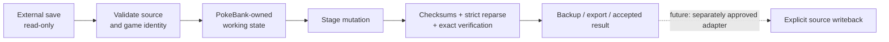

<p align="center">
  
</p>

<h1 align="center">PokeBank NX</h1>

<p align="center">
  <strong>A native, offline Pokémon bank and save-management frontend for CFW Nintendo Switch systems.</strong>
</p>

<p align="center">
  Browse supported saves, inspect Trainers / Party / Boxes / inventory, stage generation-aware Pokémon edits,
  and move toward one safe library for Pokémon across generations.
</p>

<p align="center">
  <a href="LICENSE"></a>
  
  
  
  
</p>

<p align="center">
  <a href="https://github.com/GlitchedZeus/PokeBank-NX/actions/workflows/host-tests.yml"></a>
  <a href="https://github.com/GlitchedZeus/PokeBank-NX/pull/92"></a>
  <a href="https://github.com/GlitchedZeus/PokeBank-NX/pull/92"></a>
</p>

<p align="center">
  <a href="#overview">Overview</a> •
  <a href="#project-status">Status</a> •
  <a href="#features">Features</a> •
  <a href="#supported-games">Games</a> •
  <a href="#save-safety">Safety</a> •
  <a href="#building">Build</a> •
  <a href="#roadmap">Roadmap</a> •
  <a href="#license">License</a>
</p>

---

> [!IMPORTANT]
> **PokeBank NX is active alpha software, not a finished release.** The last owner-tested integrated Gen I–IV and Product Home build is `0760334f` (October 8, 2026), which passed the reported Nintendo Switch hardware checks. Since then, the editor, touch interface, action menus and Items workflow have continued to change in separate development branches. **Those newer changes are not covered by the earlier hardware pass.** No v1.0 release or live-save write permission is implied.

## Overview

PokeBank NX brings Pokémon save management to the Nintendo Switch with a consistent interface for older generations. Choose a game, find its save, browse the Trainer, Party, Boxes and inventory, and make changes in a staged workspace rather than editing the original file in place.

The project started with the classic Game Sources workflow and has grown into a HOME-inspired frontend with game artwork, trainer context, Party previews, source assignment and a shared editor. Underneath that interface, each generation keeps its own save structure, limits and history. A Gen I Pokémon should feel like a Gen I Pokémon—not a modern record with invented fields.

The work today is centered on **a dependable Gen I–IV experience**: finishing the editor and touch interactions on hardware, expanding read-only legality checks, and keeping save custody predictable. Longer term, PokeBank NX is intended to support personal banks, search, collection tools and carefully controlled transfers.

### Design goals

- **Built for the Switch** — readable handheld UI, controller and touch interaction, useful game artwork and quick access to saves.
- **Respect the games** — generation-specific values, move restrictions and source rules, without silent conversions.
- **Keep saves safe** — external sources stay untouched during normal browsing and staged editing.
- **Make uncertainty visible** — a missing source, uncertain history or unsupported rule is reported, not guessed.
- **Prove each build** — passing automation matters, but a hardware claim belongs to the exact NRO that was tested.

## Project status

The table below separates features that have passed physical Switch testing from code that is still moving through review or device validation.

| Area | Status | Where it stands |
|---|---|---|
| Native Switch app | ✅ Working | C++20 application, devkitA64/libnx NRO builds and host/native CI |
| Gen I — R/B/Y | ✅ Device accepted | Save browsing, inventory and shared staged Pokémon editor |
| Gen II — G/S/C | ✅ Device accepted | Save browsing, generation-correct DVs/Stat Exp and shared staged editor |
| Gen III — R/S/E/FR/LG | ✅ Device accepted | Strict save parsing, Party/Boxes/inventory and shared staged editor |
| Gen IV — D/P/Pt/HG/SS | ✅ Accepted foundation | Staged editor and integrated Product Home passed on NRO `0760334f`; newer Items and picker work still needs its own testing |
| Product Home & launching | ✅ Accepted checkpoint | Quick Games, trainer/Party previews, keyboard/numpad, tested legacy/DS launch flows and Quit & Return on `0760334f` |
| Touch & action menus | 🚧 Active polish | Integrated touch foundation on application PR #92; narrow action menu and Gen III/IV touch/A parity fixes remain separate drafts |
| Gen I–IV legality | 🔬 Active development | Read-only analyzer with substantial accepted evidence and five parallel work lanes; not PKHeX parity |
| Gen V | 🧪 Experimental branch | Read-only PK5/save foundation in PR #163; not part of an accepted product workflow |
| Master Vault / Banks | ⏳ Planned | Visual entry points exist; persistent storage is not enabled |
| Direct source writeback | 🔒 Locked | No general write/inject permission for installed games or emulator sources |

> [!NOTE]
> **Last owner-accepted integrated application:** commit `0760334fb850ca46b5171c55f690998d7680d4e7`, NRO SHA-256 `4f28d7f7ad38c2b62458642e014ae3c05e866755c4152bf4c2db0574c381ce91`. The owner reported a complete pass on October 8, including the separate confirmation that **Quit & Return** worked. [Application PR #92](https://github.com/GlitchedZeus/PokeBank-NX/pull/92) has moved forward since that checkpoint and remains **open/draft, not merged into the default branch**. A newer green CI build should never be read as a newer hardware acceptance.

## Features

### Product Home

The main screen is built around the game you're using. Trainer details, the current Party, Pokédex progress and the selected save sit alongside clear **Open** and **Launch** actions.

- Game and region artwork, trainer portraits and a six-Pokémon Party preview.
- Full Games artwork browser plus a quicker Games drawer.
- Game/save/profile assignment instead of treating every similarly named file as the same source.
- Real per-save Pokédex progress where available.
- Games, Banks, Items, Search and More navigation; planned destinations are marked as such.
- Settings and profiles kept out of the main card layout.
- Shared in-app keyboard and numpad, controller navigation and focus memory.
- Sorting, Release Date ordering, Favorites and multiple visual themes.

The integrated Product Home and legacy launch paths have an owner-tested checkpoint. Later UI refinements are still under review; the layout shown in a draft branch may not match the last accepted NRO.

### Games and save sources

The Games screen is also where a save gets assigned to its game. You can inspect supported source options, reassign a validated legacy save, and see when PokeBank NX cannot determine a unique match.

Source identity remains separate from launch identity. For example, a FireRed HOME forwarder can be a launch target without becoming the source of the GBA battery save. Ambiguous game versions, duplicate save paths and unverified ROM locations are not silently resolved.

### Pokémon and inventory

The shared Gen I–IV editor covers the everyday work of viewing a Pokémon, creating or editing one in the staged workspace, and inspecting the Party, Boxes and Trainer. Fields vary by generation: Gen I/II DVs and Stat Exp are not presented as Gen III/IV IVs and EVs.

- Generation-aware species, moves and compatible move selection.
- Shiny, gender, stats, nature, abilities, held item, friendship, Pokérus, form, Ball, language and encounter fields **where the original format supports them**.
- Party/Box action flows and supported inventory editing.
- Checksums, strict save reparse and rollback on supported staged formats.
- Game-specific handling rather than broad cross-generation assumptions.

**Current Gen IV development:** Diamond, Pearl, Platinum, HeartGold and SoulSilver have Party/Box editing, empty-slot Add/Create, native move and PP controls, supported species/form changes and trainer/origin inspection. Newer work adds item-stack quantity editing, Add/Remove with guarded confirmation, clearer move details, tighter pickers and a return to the narrow greyed-out Pokémon action menu. These later changes are **development candidates**, not additions to the older `0760334f` hardware certification.

**Touch work:** a major touch foundation was integrated into the active application development branch through [PR #208](https://github.com/GlitchedZeus/PokeBank-NX/pull/208). Follow-up [#278](https://github.com/GlitchedZeus/PokeBank-NX/pull/278) and [#280](https://github.com/GlitchedZeus/PokeBank-NX/pull/280) address the shared action menu and empty-slot tap/A parity. They are not yet a claim of completed touch-only device testing.

## Supported games

| Generation | Games | Browse | Staged editor | Current scope |
|---|---|:---:|:---:|---|
| I | Red / Blue / Yellow | ✅ | ✅ | Device-accepted foundation |
| II | Gold / Silver / Crystal | ✅ | ✅ | Device-accepted foundation |
| III | Ruby / Sapphire / Emerald / FireRed / LeafGreen | ✅ | ✅ | Device-accepted foundation |
| IV | Diamond / Pearl / Platinum / HeartGold / SoulSilver | ✅ | ✅ | Integrated `0760334f` foundation accepted; newer UI/Items work untested |
| V | Black / White / Black 2 / White 2 | 🧪 | ❌ | Isolated read-only PK5 draft [#163](https://github.com/GlitchedZeus/PokeBank-NX/pull/163), not released or device accepted |
| 3DS | X/Y, ORAS, SM/USUM | 🚧 | ❌ | Provider and research groundwork only |
| Modern Switch | LGPE, SWSH, BDSP, PLA, SV, Legends Z-A | 🚧 | ❌ | Selected identity/preview/open paths tested; no general-purpose editor |

A checked entry means the supported **Gen I–IV development foundation**, not that every source provider or every release variant has the same hardware coverage. Unsupported generations are not promoted to full save/editor support because their game art or identity appears in the frontend.

## Save sources and launching

PokeBank NX treats each discovered save as a **game + provider + source identity**. A title can have more than one candidate save, and a save's location is not proof of where its ROM or forwarder lives.

The current implementation includes:

- RetroArch legacy source discovery and tested GB/GBC/GBA launch paths.
- DraStic and melonDS Gen IV source support, with provider-neutral assignment.
- Manual and remembered source selection, duplicate detection and explicit source details.
- Game-file links, bounded content discovery and exact-release matching for launch targets.
- Matching installed HOME-forwarder launch preference where the title is proven.
- A safe **Link Game File** fallback when the launch target cannot be identified.

The tested `0760334f` NRO includes working legacy RetroArch launches, Nintendo DS direct launch (Diamond was tested) and owner-confirmed **Quit & Return**. An experimental nested Return Host caused regressions and was excluded from that accepted route.

Broader provider adapters—such as generalized Tico, mGBA and 3DS source integrations—remain on the roadmap until individually implemented and validated.

> [!WARNING]
> A save path is **not** a ROM path. Launch access never grants write access to that save, and the app should ask for a source or game-file link rather than guess.

## Save safety

The save-safety contract is intentionally boring — and that is the point.



### Permanent guardrails

- ✅ Original external saves remain immutable during ordinary editing.
- ✅ Emulator-source writes remain disabled.
- ✅ Installed-title live writes remain disabled.
- ✅ Unknown or ambiguous sources fail closed.
- ✅ App-owned staged editing is allowed.
- ✅ Destructive operations require explicit intent.
- ✅ Launch capability and write capability are separate permissions.
- ❌ No global unsafe-write toggle.
- ❌ Source injection is not enabled as a side effect of editor work.
- ❌ Cross-game True Move is not broadly enabled.

The intended future transaction model is:

**fingerprint → backup → stage → validate → explicit write → readback → recovery/rollback**

Every source adapter must earn write permission independently.

## Read-only legality engine

A separate [Gen I–IV legality engine](https://github.com/GlitchedZeus/PokeBank-NX/pull/103) checks Pokémon against source-game and generation-specific evidence. Its aim is to explain what a record supports, what contradicts an independently established history, and what cannot be known from a detached Pokémon file.

The accepted isolated engine now includes work across:

- Gen I/II encounter, move, trade and Time Capsule evidence.
- Gen III handheld and GameCube PID/IV/RNG families, encounters, events and breeding.
- Gen III → IV Pal Park history, including historical move restrictions.
- Gen IV encounter tables, Method J/K lead and nature-rejection mechanics, static/gift routes, event and form evidence.
- Native PK3/PK4 source-aware checks, language, Ball and raw-field availability where established.
- Ordinary egg parent/IV/move evidence and original Platinum daycare PID histories, with strict provenance requirements.
- Candidate-scoped move histories, bounded alternative histories and exact-game source identity.

The key distinction is between **a possible candidate history** and **proof that this Pokémon actually followed it**. Original parent records, transfer decisions, distribution payloads and RNG state are often no longer available. The analyzer must not invent them.

| Result | Meaning |
|---|---|
| **Invalid** | The checks have enough applicable, source-backed evidence to prove a contradiction |
| **No problems found** | The checks that ran found no contradiction; untested history is not certified |
| **Incomplete** | The relevant source, historical evidence or verification coverage is insufficient |

### Five coordinated legality work lanes

On October 12, development moved to a [90-package master inventory](https://github.com/GlitchedZeus/PokeBank-NX/pull/291) so research, implementation and independent testing can progress together instead of repeating the same groundwork.

| Area | Development |
|---|---|
| [Encounters & wild RNG](https://github.com/GlitchedZeus/PokeBank-NX/pull/293) | Original encounter methods, lead effects and PID/IV candidate histories |
| [Breeding & eggs](https://github.com/GlitchedZeus/PokeBank-NX/pull/295) | Gen III/IV inheritance, original parent/egg stages and breeding alternatives |
| [Moves & transfers](https://github.com/GlitchedZeus/PokeBank-NX/pull/296) | Four-move acquisition chronology, evolution and Pal Park |
| [Events & metadata](https://github.com/GlitchedZeus/PokeBank-NX/pull/292) | Distribution provenance, trainer/raw text, ribbons, Balls and dates |
| [Research & QA](https://github.com/GlitchedZeus/PokeBank-NX/pull/294) | Pinned original sources, cross-game coverage and independent fixtures |

These are active **draft development/research PRs**, not five features already shipped in an NRO. The central legality branch remains isolated from the Product UI and default branch while exact-head tests and integration are completed. The 90 packages are a working inventory, **not** a percentage of PKHeX coverage.

> [!CAUTION]
> Legality analysis is **read-only**. It does not fix or rewrite a Pokémon, authorize save injection, or claim PKHeX-level completeness. Unknown original history, unsupported mechanics and an exhausted search remain **Incomplete**, not automatically Invalid.

## Engineering quality

PokeBank NX is checked at more than one level:

- Host regressions covering save parsing, editor rules, UI contracts and source custody.
- ASan/UBSan runs and malformed-save quarantine tests.
- Generated data, art/asset and native packaging checks.
- Clean devkitA64/libnx builds and NRO artifacts for exact commits.
- Focused Gen I–IV editor, source-opening, move and save-recovery tests.
- Physical Switch testing against an exact NRO, not just a passing branch.

The full repository forensic audit was completed, and the remediation was integrated into the active application branch in [PR #101](https://github.com/GlitchedZeus/PokeBank-NX/pull/101): **43 verified/fixed findings, one explicitly deferred, none left open in that audit ledger**. The deferred trainer-name presentation case still needs a real failing disposable Gen IV save; it is not being hidden by fabricating a name.

The five legality lanes also produce standalone native and source-research tests. Some of those tests still need to be registered in the shared host build and rerun on a reconciled exact commit; existing green CI alone does **not** certify tests that were not executed.

<details>
<summary><strong>Active engineering branches and checkpoints</strong></summary>

| Branch / PR | Purpose and current boundary |
|---|---|
| [#92 — Gen I–IV application](https://github.com/GlitchedZeus/PokeBank-NX/pull/92) | **Open/draft.** Contains the hardware-accepted `0760334f` ancestor and newer editor/Items/touch work that needs fresh exact-build validation |
| [#208 — touch integration](https://github.com/GlitchedZeus/PokeBank-NX/pull/208) | Integrated into the **application development branch**, not the default `main`; new combined heads need hardware testing |
| [#278 / #280 — actions and empty-slot touch](https://github.com/GlitchedZeus/PokeBank-NX/pull/278) | Narrow greyed-out Gen I–IV action menu and Gen III/IV tap/A behavior; separate open drafts |
| [#103 — read-only legality](https://github.com/GlitchedZeus/PokeBank-NX/pull/103) | **Open/draft.** Accepted isolated checkpoint `d29eada5` includes source-linked Platinum breeding and earlier Gen I–IV evidence; not merged into Product UI or default `main` |
| [#284 — HGSS egg PID](https://github.com/GlitchedZeus/PokeBank-NX/pull/284) | Separate source-attested breeding candidate with exact-head CI; draft until integrated |
| [#291 — master legality plan](https://github.com/GlitchedZeus/PokeBank-NX/pull/291) | 90 tracked packages and five parallel ownership lanes; planning work, not an engine release |
| [#163 — experimental Gen V](https://github.com/GlitchedZeus/PokeBank-NX/pull/163) | Read-only PK5/save foundation; separate open draft, no full Gen V editor/hardware claim |
| [#101 — forensic remediation](https://github.com/GlitchedZeus/PokeBank-NX/pull/101) | Integrated into PR #92 development history; audit evidence retained |

These links are development checkpoints, not a list of released features. GitHub and the exact tested NRO remain authoritative.

</details>

## Building

PokeBank NX targets Nintendo Switch homebrew using **C++20**, **devkitPro / devkitA64 / libnx**, **SDL2** for platform/window/input support, and **NanoVG/OpenGL** for the current renderer.

### Requirements

- devkitPro;
- devkitA64;
- libnx;
- GNU Make;
- a CFW Nintendo Switch / homebrew environment for device testing.

The Makefile requires `DEVKITPRO` to be set in the environment.

```bash
git clone https://github.com/GlitchedZeus/PokeBank-NX.git
cd PokeBank-NX
make
```

The native target is `PokeBankNX.nro`.

> [!NOTE]
> There is no v1.0 release yet. For development/hardware candidates, GitHub Actions is the reproducible build path used by the project. Hardware acceptance is tied to the exact application commit and exact built NRO, not merely to a nearby green commit.

## Installation

For a locally built/development NRO:

1. Create a folder such as `sdmc:/switch/PokeBank-NX/`.
2. Copy `PokeBankNX.nro` into that folder.
3. Launch it from the Switch homebrew menu.
4. Keep your real saves backed up and treat development builds as development builds.

PokeBank NX does not provide commercial game ROMs or console firmware.

## Repository layout

| Path | Purpose |
|---|---|
| `src/` | Application, UI, save, Pokémon, conversion, legality and integration code |
| `include/` | Public/internal interfaces and shared models |
| `romfs/` | Runtime presentation/data assets packaged into the NRO |
| `assets/` | Application metadata/icon resources |
| `tests/` | Host regression and safety-contract tests |
| `tools/` | Data generation, asset preparation and maintenance utilities |
| `.github/workflows/` | Host, sanitizer and native Switch CI |
| `docs/` | Engineering status, support matrices, architecture and roadmap documentation |

## Roadmap

PokeBank NX has a working Gen I–IV foundation. The next job is to finish and validate it as one dependable product before treating experimental branches as released support.

1. **Finish Gen I–IV hardware polish.** Complete the editor, Items, compact action menus, touch/A parity and game/source navigation on one exact integrated build. Preserve the owner-tested launch and Quit & Return behavior.
2. **Complete touch-only workflows.** Verify controller/touch coexistence, modal scrolling, keyboard/numpad, storage and editor pickers on real Switch hardware.
3. **Advance legality in parallel.** Integrate source-backed Gen I–IV work from the five independent lanes, register their tests in shared CI and grow the authentic golden fixture corpus before promising PKHeX parity.
4. **Broaden save/provider support carefully.** Keep the Gen V PK5 foundation and later DS/3DS/modern Switch adapters experimental until each earns its own parser, UI and hardware acceptance.
5. **Build the collection layer.** Master Vault, named Banks, provenance, search and Living Dex workflows are future product milestones, not active persistence today.
6. **Introduce controlled source transactions only when ready.** Individual source adapters must prove backup, fingerprint, validation, readback and recovery before any write feature can be approved.
7. **Prepare v1.0.** Harden diagnostics, performance, handheld/docked accessibility and full release-candidate hardware coverage.

The [v1.0 roadmap](docs/V1_ROADMAP.md) carries the longer milestone breakdown, while the [legality master plan](https://github.com/GlitchedZeus/PokeBank-NX/pull/291) tracks the independent legality work. The app, touch, legality and experimental-generation branches stay separate until their acceptance gates are met.

## Bug reports

Useful hardware reports include:

- PokeBank NX version / build SHA;
- exact NRO hash when available;
- Switch mode (handheld/docked);
- game and generation;
- source/provider (RetroArch, DraStic, melonDS, manual, etc.);
- exact steps to reproduce;
- screenshots or video when the issue is visual.

Please avoid posting personal/private save files publicly. Use a disposable test save when a reproduction requires writable or sensitive data.

## Project documentation

This README is a guide to the project, not a live commit ledger. The detailed work and its evidence are tracked here:

- [Current Engineering Status](CURRENT_STATUS.md) — historical checkpoints and exact-build notes (some entries predate the latest PR activity);
- [Project Status](PROJECT_STATUS.md) — broader implementation and milestone history;
- [Game Support Matrix](docs/GAME_SUPPORT_MATRIX.md) — per-generation support and limitations;
- [v1.0 Roadmap](docs/V1_ROADMAP.md) — product milestones;
- [UI Ownership Status](docs/UI_OWNERSHIP_STATUS.md) — product screen ownership and remaining work;
- [Application PR #92](https://github.com/GlitchedZeus/PokeBank-NX/pull/92) — active Gen I–IV editor/Product Home development;
- [Legality PR #103](https://github.com/GlitchedZeus/PokeBank-NX/pull/103) and [master worklist PR #291](https://github.com/GlitchedZeus/PokeBank-NX/pull/291) — isolated legality engine and five coordinated development lanes.

**Status note:** historical docs may still name an older SHA or pending hardware candidate. Prefer the live linked PRs and recorded exact device acceptance over a stale date in a status file.

## License

PokeBank NX is licensed under the **GNU Affero General Public License v3.0 (AGPL-3.0)**.

> [!NOTE]
> The complete license terms are in [LICENSE](LICENSE). The README is not a substitute for the license text.

Third-party code, data, research, artwork sources, and reference projects retain their own licenses and attribution requirements.

## Disclaimer

PokeBank NX is an unofficial fan-made homebrew project and is not affiliated with or endorsed by Nintendo, The Pokémon Company, GAME FREAK, or Creatures Inc.

Pokémon and related trademarks and game assets are property of their respective owners.