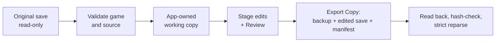
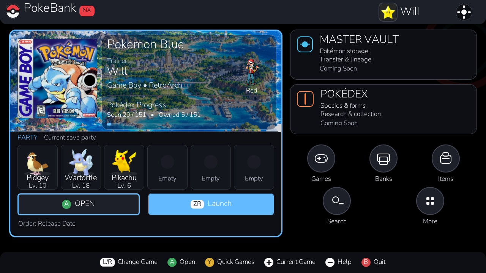
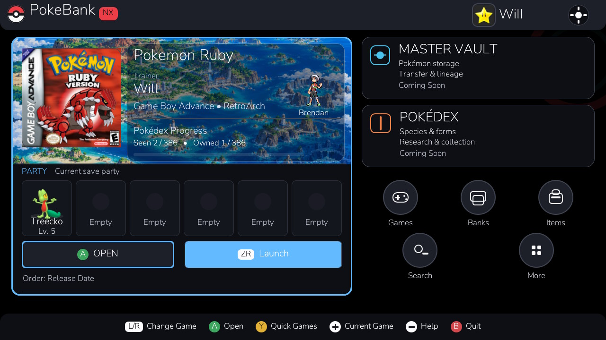
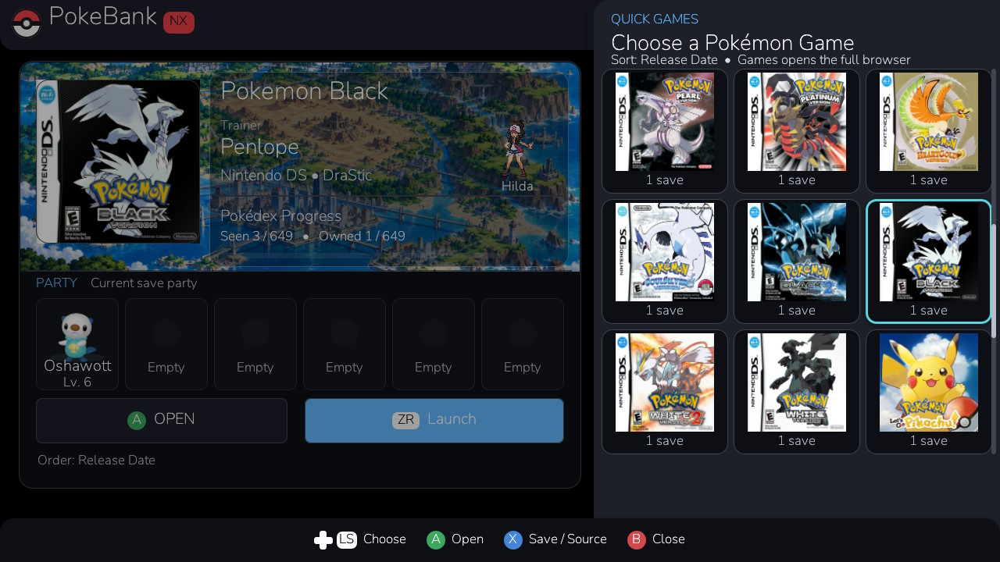
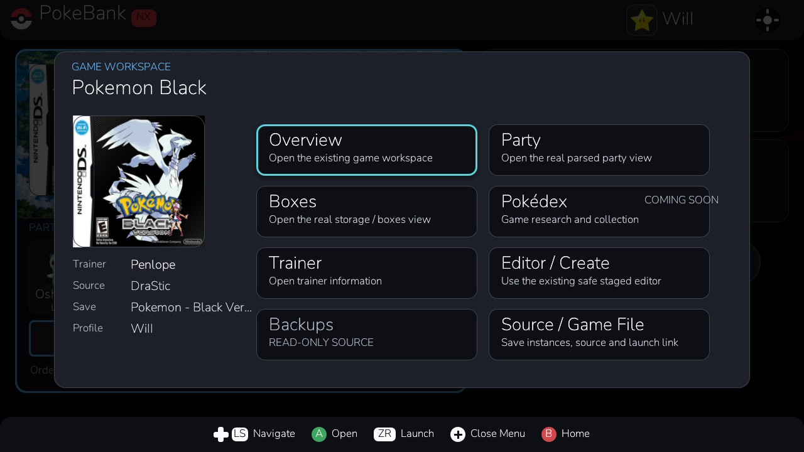
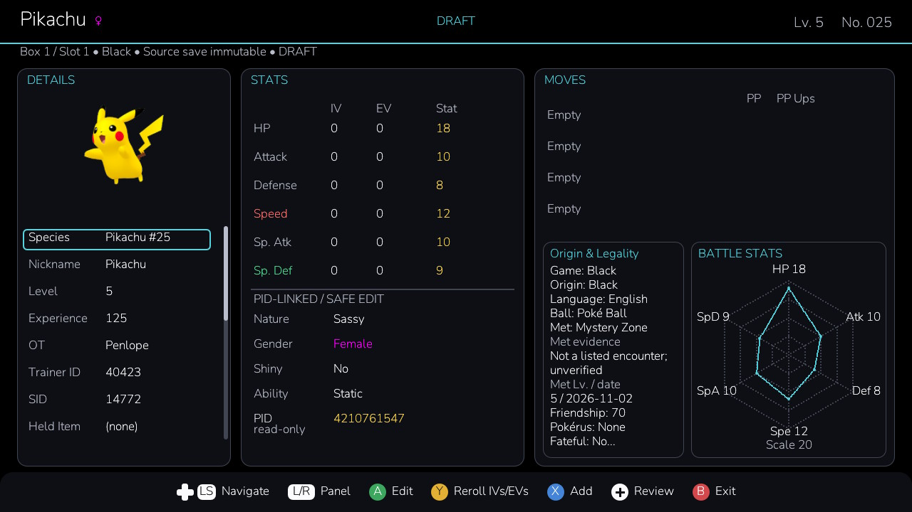
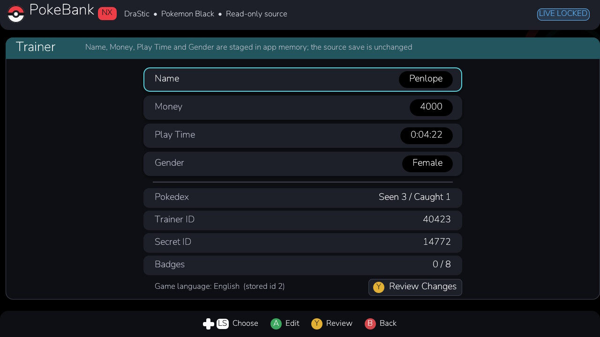
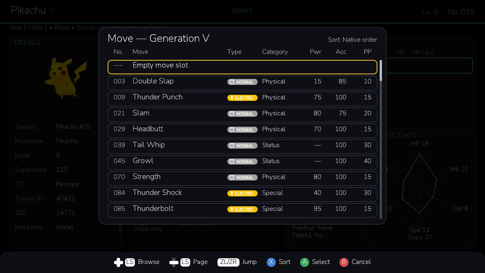
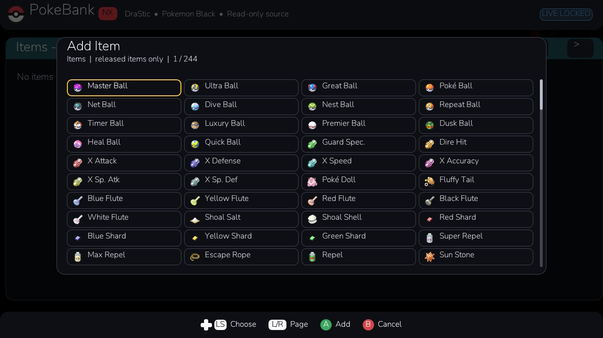

<p align="center">
  
</p>

<h1 align="center">PokeBank NX</h1>

<p align="center">
  <strong>A native, offline Pokémon bank and save-management frontend for CFW Nintendo Switch systems.</strong>
</p>

<p align="center">
  Browse supported saves, inspect Trainers / Party / Boxes / inventory, stage generation-aware Pokémon edits,
  and move toward one safe library for Pokémon across generations.
</p>

<p align="center">
  <a href="LICENSE"></a>
  
  
  
  
</p>

<p align="center">
  <a href="https://github.com/GlitchedZeus/PokeBank-NX/actions/workflows/host-tests.yml"></a>
  <a href="docs/STATUS.md"></a>
  <a href="docs/STATUS.md"></a>
</p>

<p align="center">
  <a href="#overview">Overview</a> •
  <a href="#screenshots">Screenshots</a> •
  <a href="#project-status">Status</a> •
  <a href="#supported-games">Games</a> •
  <a href="#install-and-use">Install</a> •
  <a href="#save-safety">Safety</a> •
  <a href="#road-to-v10">Roadmap</a> •
  <a href="#contributing-and-bug-reports">Contribute</a> •
  <a href="#license">License</a>
</p>

---

> [!IMPORTANT]
> **Alpha software, no stable release, not hardware accepted.** The latest owner-tested Gen I–V build is the
> Round 14 candidate (`d160aa42`), which was **not accepted**: the owner's quick check recorded 7 PASS and 11 FAIL,
> including save-assignment and profile-isolation blockers tracked in
> [#313](https://github.com/GlitchedZeus/PokeBank-NX/issues/313). Round 15 repairs (PR #338 and the
> `fix/round15-gen15-repairs` branch) target those blockers. Your original saves are never written:
> edits are exported as a separate, verified copy. Keep your own backups anyway.
> Current state: [docs/STATUS.md](docs/STATUS.md).

## Overview

PokeBank NX is a Nintendo Switch homebrew app for the Pokémon games you play **through emulators on your
Switch**: the Game Boy, Game Boy Color, Game Boy Advance and Nintendo DS generations (Gen I–V), in RetroArch,
DraStic and similar emulators, and the Nintendo Switch Online releases where they are supported.

It finds your saves, shows the Trainer, Party, Boxes and Bag in a consistent Switch-friendly interface, and lets
you edit Pokémon and items in a staged workspace. Nothing touches the original save: when you are done, PokeBank
NX writes a new, verified copy next to an exact backup of the original.

Each generation keeps its own native rules. A Gen I Pokémon is edited with DVs and Stat Exp, not with modern
fields it never had.

The long-term goal is a **Master Vault**: one safe library that holds Pokémon across games and generations. That
part is not built yet.

## Project status

| Area | Status |
|---|---|
| Gen I–V application | **Alpha.** Usable for browsing and staged editing; repaired round by round against owner hardware tests. Not yet accepted across all 20 games. |
| Current candidate | The latest build and its exact SHA-256 are always listed in [docs/STATUS.md](docs/STATUS.md) and [docs/RELEASES.md](docs/RELEASES.md). Every candidate is **NOT DEVICE TESTED** until the owner tests that exact file. |
| Last hardware results | Round 14 `d160aa42` (Nov 2): quick check 7 PASS / 11 FAIL, **not accepted** (save assignment, profile isolation, Black 2 Items route; see [#313](https://github.com/GlitchedZeus/PokeBank-NX/issues/313)). Round 13 `9c301c48`: 15 PASS / 12 FAIL ([results](docs/hardware/round13/OWNER_RESULTS_9c301c48.json)). |
| Master Vault, cross-game storage and transfer | **Not implemented.** Required for v1.0. |
| Gen VI–IX (3DS and Switch-native games) | **Paused** on `development/gen6-plus`. Not feature complete; its first hardware candidate (`5895e6b9`) failed owner testing. |
| Legality engine | **Paused** at [PR #314](https://github.com/GlitchedZeus/PokeBank-NX/pull/314). Not part of the app. |

Every build and its hardware result: [docs/RELEASES.md](docs/RELEASES.md) · round history:
[CHANGELOG.md](CHANGELOG.md) · candidate archive: [docs/hardware/NRO_ARCHIVE.md](docs/hardware/NRO_ARCHIVE.md).

## Supported games

| Generation | Games | Status |
|---|---|---|
| I | Red, Blue, Yellow | Alpha: browse and staged editing. Japanese saves are read-only. |
| II | Gold, Silver, Crystal | Alpha: browse and staged editing. Japanese saves are read-only. |
| III | Ruby, Sapphire, Emerald, FireRed, LeafGreen | Alpha: browse and staged editing |
| IV | Diamond, Pearl, Platinum, HeartGold, SoulSilver | Alpha: browse and staged editing |
| V | Black, White, Black 2, White 2 | Alpha: browse and staged editing |
| VI–IX | 3DS and Switch titles | Paused; not part of the current app |

Save providers: RetroArch (Game Boy, Game Boy Color, GBA), DraStic, melonDS and manually chosen files (DS), and
Nintendo Switch Online FireRed / LeafGreen (recognised by title ID; installed-game saves are read-only). Details:
[game support matrix](docs/user/GAME_SUPPORT_MATRIX.md).

## What works and what is experimental

**Working in the alpha** (owner-tested on recent candidates, still being accepted game by game):

- Save discovery, assigning a save to its game, and choosing a primary or backup copy.
- Trainer, Party, Boxes and Bag for all 20 Gen I–V releases, with game artwork on Home.
- One generation-aware Pokémon editor: View, Edit, Create, Clone, Move within a save, Release.
- Bag editing, including Top Up / Add Missing.
- Review of every staged change, then **Export Copy** to a new verified file.
- Save Backups history and a Recovery files view.

**Experimental or still being repaired** (see [docs/STATUS.md](docs/STATUS.md) and issue [#313](https://github.com/GlitchedZeus/PokeBank-NX/issues/313)):

- Single-Pokémon import and export (`.pk1`–`.pk5`, `.ek3`–`.ek5`).
- Met Location and origin choices: the lists are being replaced with source-backed encounter data.
- Gen V box controls, Clone/Move pop-ups and the Gen I/II box carry cursor (Round 12 findings).
- Loading an exported save in an emulator has not yet been confirmed on hardware for every game.

**Not built yet:** Master Vault, Move to Vault, Vault deposit / withdraw and search, cross-generation transfer,
renaming boxes inside a save. These are v1.0 requirements.

## Install and use

You need a Nintendo Switch running custom firmware with the Homebrew Menu (for example Atmosphère with hbmenu),
and your games set up in an emulator on the Switch. PokeBank NX does not provide games, ROMs, keys or firmware.

1. Download the latest candidate `.nro` from the pre-release named in [docs/STATUS.md](docs/STATUS.md) and check its
   SHA-256 against the value listed there. Every candidate is a test build; earlier builds and their results are
   in [docs/RELEASES.md](docs/RELEASES.md).
2. Back up your saves.
3. Create `sdmc:/switch/PokeBank-NX/` on the SD card and copy the `.nro` into it.
4. Launch **PokeBank NX** from the Homebrew Menu.

Using it:

1. Pick a game on **Home**. If more than one save matches, choose the right one (primary or backup copy).
2. Browse the Trainer, Party, Boxes and Bag. The footer on every screen shows the buttons for that screen.
3. Make changes. They stay in a staged workspace until you choose otherwise.
4. Open **Review** to see every pending change, then choose **Export Copy**, or **Discard** to drop them.
5. The export is written under `sdmc:/switch/PokeBank-NX/exports/`. To play with it, back up your emulator's
   save and replace it with the exported file yourself. PokeBank NX never does this for you.

The app keeps its settings, logs, backups and exports under `sdmc:/switch/PokeBank-NX/`
([details](docs/STANDALONE_RUNTIME.md)).

## Save safety



- **Original saves are never written.** Emulator and installed-game saves are read-only sources; live writes are
  disabled in code, not by a setting.
- **Edits are staged.** Nothing leaves the working copy until you export.
- **Export Copy is verified.** It writes an exact backup of the original plus the edited save and a manifest,
  reads them back, checks hashes and strictly reparses the edited save (checksums included). A failure leaves no
  partial export, and an existing export is never overwritten.
- **No direct injection** into an emulator or game save, and **no cross-game Move**.
- **Japanese Gen I/II saves are read-only** until their native writers are proven.
- **Unknown or ambiguous saves are refused**, not guessed.

These guarantees are tested for all 18 Gen I–V export paths ([save-safety chain](docs/qa/SAVE_SAFETY_CHAIN.md));
the design is in the [save-safety contract](docs/user/SAVE_SAFETY.md).

## Road to v1.0

1. **Finish Gen I–V hardware acceptance.** Repair what each round finds, until one exact NRO passes the full
   [20-game hardware gate](docs/handoffs/GEN15_HARDWARE_ACCEPTANCE_GATE_20261015.md) (issue
   [#313](https://github.com/GlitchedZeus/PokeBank-NX/issues/313)).
2. **Build the v1.0 storage features:** Master Vault, Move to Vault from the Actions menu, persistent deposit and
   withdraw, Vault search, cross-generation transfer and in-save box renaming
   ([Master Vault spec](docs/roadmap/MASTER_VAULT_SPEC.md), [transfer model](docs/roadmap/TRANSFER_MODEL.md)).
3. **Source-backed gift and static encounter data** for Met Location and origin (in progress).
4. Then resume the legality engine and Gen VI–IX.

Tracking: [v1.0 feature gaps](https://github.com/GlitchedZeus/PokeBank-NX/blob/fix/round12-gen15-repairs/docs/qa/V1_RELEASE_FEATURE_GAPS.md) ·
[master hardware acceptance ledger](https://github.com/GlitchedZeus/PokeBank-NX/blob/fix/round12-gen15-repairs/docs/qa/MASTER_HARDWARE_ACCEPTANCE_LEDGER.md)
(both on `fix/round12-gen15-repairs` until it merges) · [v1.0 roadmap](docs/V1_ROADMAP.md) ·
[issue #29](https://github.com/GlitchedZeus/PokeBank-NX/issues/29).

## Screenshots

Actual Nintendo Switch screenshots captured by the project owner on November 2, 2026. This is an alpha UI preview,
not evidence of release acceptance. The latest hardware results are in [docs/STATUS.md](docs/STATUS.md).

| Pokémon Blue dashboard | Pokémon Ruby dashboard |
| --- | --- |
|  |  |

| Quick Games | Game workspace |
| --- | --- |
|  |  |

| Pokémon editor | Trainer editor |
| --- | --- |
|  |  |

| Move chooser | Add Item chooser |
| --- | --- |
|  |  |

[View all 18 screenshots](docs/screenshots.md), including controller help, party, boxes, pickers and an experimental
Legends Z-A dashboard preview. The older images in `assets/screenshots/` are from the upstream PKSE project and are
not shown as this app.

## Building

PokeBank NX is C++20 for devkitPro / devkitA64 / libnx, with SDL2 and NanoVG on OpenGL.

```bash
git clone --recursive https://github.com/GlitchedZeus/PokeBank-NX.git
cd PokeBank-NX
make -f Makefile.host -j"$(nproc)" host-test   # host test suite, no Switch needed
make -j2                                       # PokeBankNX.nro (needs DEVKITPRO)
```

The full RomFS artwork is restored from a recovery snapshot before a release-quality NRO build; see
[CONTRIBUTING.md](CONTRIBUTING.md#building). Code map: [docs/ARCHITECTURE.md](docs/ARCHITECTURE.md).

## Contributing and bug reports

- **Bugs:** open a [bug report](https://github.com/GlitchedZeus/PokeBank-NX/issues/new/choose) with the exact NRO
  name and SHA-256, the game and emulator, and the steps. Do not post real save files publicly.
- **Anything that changed or damaged a save:** report it privately; see [SECURITY.md](SECURITY.md).
- **Code and docs:** read [CONTRIBUTING.md](CONTRIBUTING.md). Issues labelled `good first issue` and
  `help wanted` are a good start.

## Documentation

[docs/README.md](docs/README.md) indexes everything: user guides, development notes, hardware QA, legality
research, the Vault and roadmap, and an archive of historical session notes.

## License

PokeBank NX is licensed under the **GNU Affero General Public License v3.0 (AGPL-3.0)**.

> [!NOTE]
> The complete license terms are in [LICENSE](LICENSE). The README is not a substitute for the license text.

Third-party code, data, research, artwork sources, and reference projects retain their own licenses and attribution requirements.

## Disclaimer

PokeBank NX is an unofficial fan-made homebrew project and is not affiliated with or endorsed by Nintendo, The Pokémon Company, GAME FREAK, or Creatures Inc.

Pokémon and related trademarks and game assets are property of their respective owners.
