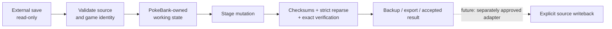

<p align="center">
  
</p>

<h1 align="center">PokeBank NX</h1>

<p align="center">
  <strong>A native, offline Pokémon bank and save-management frontend for CFW Nintendo Switch systems.</strong>
</p>

<p align="center">
  Browse supported saves, inspect Trainers / Party / Boxes / inventory, stage generation-aware Pokémon edits,
  and move toward one safe library for Pokémon across generations.
</p>

<p align="center">
  <a href="LICENSE"></a>
  
  
  
  
</p>

<p align="center">
  <a href="https://github.com/GlitchedZeus/PokeBank-NX/actions/workflows/host-tests.yml"></a>
  <a href="https://github.com/GlitchedZeus/PokeBank-NX/pull/306"></a>
  <a href="https://github.com/GlitchedZeus/PokeBank-NX/pull/300"></a>
</p>

<p align="center">
  <a href="#overview">Overview</a> •
  <a href="#project-status">Status</a> •
  <a href="#features">Features</a> •
  <a href="#supported-games">Games</a> •
  <a href="#save-safety">Safety</a> •
  <a href="#building">Build</a> •
  <a href="#roadmap">Roadmap</a> •
  <a href="#license">License</a>
</p>

---

> [!IMPORTANT]
> **Active alpha — no v1.0 release.** Last **owner-accepted** integrated Gen I–IV / Product Home build: `0760334f` (October 8, 2026). The newer Gen I–IV finalization [#306](https://github.com/GlitchedZeus/PokeBank-NX/pull/306), Gen V [#300](https://github.com/GlitchedZeus/PokeBank-NX/pull/300), and legality [#298](https://github.com/GlitchedZeus/PokeBank-NX/pull/298)/[#303](https://github.com/GlitchedZeus/PokeBank-NX/pull/303) remain separate development branches. Gen V #300 passed **six exact-head CI checks** at `58bd564b` but still needs owner Switch testing. #306's latest candidate/native/Gen IV/touch gates have passed while its full host suite is still running; the legality coordinator has outstanding CI failures; none of these changes is a released or hardware-accepted v1.0 build. See [the October 14 project snapshot](docs/ENGINEERING_SNAPSHOT_20261014.md).

## Overview

PokeBank NX brings Pokémon save management to the Nintendo Switch with a consistent interface for older generations. Choose a game, find its save, browse the Trainer, Party, Boxes and inventory, and make changes in a staged workspace rather than editing the original file in place.

The project started with the classic Game Sources workflow and has grown into a HOME-inspired frontend with game artwork, trainer context, Party previews, source assignment and a shared editor. Underneath that interface, each generation keeps its own save structure, limits and history. A Gen I Pokémon should feel like a Gen I Pokémon—not a modern record with invented fields.

Current work centers on **one reliable Gen I–IV candidate**, a separately verified **Gen V BW/B2W2 staged-editor candidate**, and ongoing read-only legality research. Persistent Master Vault, collection services and direct original-save writeback remain separate future milestones.

### Design goals

- **Built for the Switch** — readable handheld UI, controller and touch interaction, useful game artwork and quick access to saves.
- **Respect the games** — generation-specific values, move restrictions and source rules, without silent conversions.
- **Keep saves safe** — external sources stay untouched during normal browsing and staged editing.
- **Make uncertainty visible** — a missing source, uncertain history or unsupported rule is reported, not guessed.
- **Prove each build** — passing automation matters, but a hardware claim belongs to the exact NRO that was tested.

## Project status

**Verified against live GitHub October 14, 2026.** “Implemented on a draft branch” is not equivalent to “merged”, “released” or “physically tested”.

| Area | Progress | Evidence / remaining gate |
|---|---|---|
| Native Switch application | ✅ Established | C++20/devkitA64 builds, host regression and sanitizer gates |
| Gen I — R/B/Y | ✅ Accepted foundation | Shared staged editor, sources and Items; latest integrated UI still needs retest |
| Gen II — G/S/C | ✅ Accepted foundation | Native DV/Stat Exp/Pokérus and editor; latest integrated UI retest pending |
| Gen III — R/S/E/FR/LG | ✅ Accepted foundation | Trainer/Party/Boxes, native staged editing/inventory; launch/touch polish ongoing |
| Gen IV — D/P/Pt/HG/SS | ✅ Earlier milestone; 🚧 finalizing | Shared editor and Items; [#306](https://github.com/GlitchedZeus/PokeBank-NX/pull/306) artwork, DS fairness and ROM-header candidate gates green; full host/device acceptance pending |
| Product Home & launching | ✅ Earlier hardware checkpoint; 🚧 new fixes | Artwork, Quick Games, trainer/Party previews, launch and Quit & Return; new packaged NRO audit in #306 |
| Gen V — B/W/B2/W2 | 🧪 Experimental shared editor / **CI green** | [#300](https://github.com/GlitchedZeus/PokeBank-NX/pull/300): validated Save Instances, profile assignment, primary/backup choice, native PK5 Edit/Create/Review, app-owned export; **device acceptance pending** |
| Gen V profile/source hardening | 🧪 Separate draft | [#304](https://github.com/GlitchedZeus/PokeBank-NX/pull/304): extra persistent copy/identity, fair provider discovery, navigation/repair; reconciliation pending |
| Touch and action menus | 🚧 Hardware polish | Shared controller/touch navigation, narrow greyed-out actions and empty-slot parity |
| Gen I–IV legality | 🔬 Active five-lane development | [#298](https://github.com/GlitchedZeus/PokeBank-NX/pull/298) and [#303](https://github.com/GlitchedZeus/PokeBank-NX/pull/303) expand original-source / PKHeX differential testing; combined CI still blocked |
| Gen V–IX legality | 🔬 Preliminary foundation | [#301](https://github.com/GlitchedZeus/PokeBank-NX/pull/301) native-envelope/domain work, not historical PKHeX parity |
| Master Vault, Banks, global Search | ⏳ Planned | UI placeholders ≠ persistent storage |
| Installed/emulator original-save writes | 🔒 Locked | No blanket Inject Save or source overwrite |

> [!NOTE]
> Last owner-accepted integrated source: `0760334fb850ca46b5171c55f690998d7680d4e7`, NRO SHA-256 `4f28d7f7ad38c2b62458642e014ae3c05e866755c4152bf4c2db0574c381ce91`. The latest Gen V [six-check-green NRO artifact](https://github.com/GlitchedZeus/PokeBank-NX/actions/runs/38523683607) is **not owner-tested**. Physical device sign-off always belongs to an exact NRO, not a PR title or green badge.

## Features

### Product Home

The main screen is built around the game you're using. Trainer details, the current Party, Pokédex progress and the selected save sit alongside clear **Open** and **Launch** actions.

- Game and region artwork, trainer portraits and a six-Pokémon Party preview.
- Full Games artwork browser plus a quicker Games drawer.
- Game/save/profile assignment instead of treating every similarly named file as the same source.
- Real per-save Pokédex progress where available.
- Games, Banks, Items, Search and More navigation; planned destinations are marked as such.
- Settings and profiles kept out of the main card layout.
- Shared in-app keyboard and numpad, controller navigation and focus memory.
- Sorting, Release Date ordering, Favorites and multiple visual themes.

The integrated Product Home and legacy launch paths have an owner-tested checkpoint. Later UI refinements are still under review; the layout shown in a draft branch may not match the last accepted NRO.

### Games and save sources

The Games screen is also where a save gets assigned to its game. You can inspect supported source options, reassign a validated legacy save, and see when PokeBank NX cannot determine a unique match.

Source identity remains separate from launch identity. For example, a FireRed HOME forwarder can be a launch target without becoming the source of the GBA battery save. Ambiguous game versions, duplicate save paths and unverified ROM locations are not silently resolved.

### Pokémon and inventory

The **same shared editor shell** serves Gen I–IV and the experimental Gen V branch; generation-native format rules are retained rather than silently upgrading old Pokémon.

- **Gen I–III:** accepted foundation for Trainer / Party / Boxes / Items and shared staged View/Create/Edit.
- **Gen IV:** shared Party/Box editing, Create/Add, native species/form, item, move/PP and origin fields. New touch/action/Items changes still require the integrated hardware round.
- **Gen V:** [#300](https://github.com/GlitchedZeus/PokeBank-NX/pull/300) implements Black/White/Black 2/White 2 native PK5 parsing, Trainer/Party/24 Boxes, staged field editing, moves and PP, native Create, Review and **app-owned working-copy export**; an original emulator SAV5 remains immutable.
- **Controller and touch:** shared D-pad/left stick and touch-first interfaces, narrower conditional Actions, picker focus preservation and staged exit/review contracts; the latest combination remains a device candidate.
- **Legality:** source-specific, conservative read-only evidence; unsupported historical mechanics are Unknown/Incomplete, not invented Invalid.

**Gen I–IV finalization** now proceeds on Claude's [PR #306](https://github.com/GlitchedZeus/PokeBank-NX/pull/306) with exact NRO RomFS/cover/portrait verification, per-root fair DS discovery and GB/GBA/NDS ROM-header identity checks. [#305](https://github.com/GlitchedZeus/PokeBank-NX/pull/305) separately tracks Gen IV native Ball `max(0x83,0x86)`. These newer candidates are **not** the older `0760334f` device-accepted NRO.

**Touch work:** [#208](https://github.com/GlitchedZeus/PokeBank-NX/pull/208), [#278](https://github.com/GlitchedZeus/PokeBank-NX/pull/278) and [#280](https://github.com/GlitchedZeus/PokeBank-NX/pull/280) contribute the integrated touch foundation and stacked narrow-action / empty-slot parity work; full touch-only device acceptance is pending.

## Supported games

| Generation | Games | Read/source | Staged editor | Owner acceptance |
|---|---|:---:|:---:|---|
| I | Red / Blue / Yellow | ✅ | ✅ | ✅ Earlier accepted foundation |
| II | Gold / Silver / Crystal | ✅ | ✅ | ✅ Earlier accepted foundation |
| III | Ruby / Sapphire / Emerald / FireRed / LeafGreen | ✅ | ✅ | ✅ Earlier accepted foundation |
| IV | Diamond / Pearl / Platinum / HeartGold / SoulSilver | ✅ | ✅ | ✅ Earlier integrated milestone; latest polish pending |
| V | Black / White / Black 2 / White 2 | 🧪 [#300](https://github.com/GlitchedZeus/PokeBank-NX/pull/300) | 🧪 Shared staged PK5 | ❌ **Hardware pending** |
| VI–VII / 3DS | X/Y, ORAS, SM/USUM | 🚧 | ❌ | ❌ |
| Modern Switch | LGPE, SWSH, BDSP, PLA, SV, Legends Z-A | 🚧 | ❌ generally | ❌ broad acceptance |

✅ means a previously supported/accepted foundation, 🧪 an **unmerged candidate**, 🚧 partial research/provider/identity groundwork, and ❌ no general production acceptance. Artwork or a Games card does not by itself indicate a validated save editor.

## Save sources and launching

PokeBank NX treats each discovered save as a **game + provider + source identity**. A title can have more than one candidate save, and a save's location is not proof of where its ROM or forwarder lives.

The current implementation includes:

- RetroArch legacy source discovery and tested GB/GBC/GBA launch paths.
- DraStic and melonDS Gen IV source support, with provider-neutral assignment.
- Experimental Gen V RetroArch/DraStic/melonDS/manual **Save Instances**, exact BW/B2W2 matching, explicit Primary/Backup choice, **Assign Save to This Profile** and strict reopen fingerprint checks ([#300](https://github.com/GlitchedZeus/PokeBank-NX/pull/300)).
- Manual and remembered source selection, duplicate detection and explicit source details.
- Game-file links, bounded content discovery and exact-release matching for launch targets.
- Matching installed HOME-forwarder launch preference where the title is proven.
- A safe **Link Game File** fallback when the launch target cannot be identified.

The tested `0760334f` NRO includes working legacy RetroArch launches, Nintendo DS direct launch (Diamond was tested) and owner-confirmed **Quit & Return**. An experimental nested Return Host caused regressions and was excluded from that accepted route.

Gen I–III provider-specific bounded discovery already has mGBA and Tico groundwork in its development lineage. Cross-generation provider completeness and Switch acceptance vary; generalized 3DS and additional emulator adapters remain roadmap work.

> [!WARNING]
> A save path is **not** a ROM path. Launch access never grants write access to that save, and the app should ask for a source or game-file link rather than guess.

## Save safety

The save-safety contract is intentionally boring — and that is the point.



### Permanent guardrails

- ✅ Original external saves remain immutable during ordinary editing.
- ✅ Emulator-source writes remain disabled.
- ✅ Installed-title live writes remain disabled.
- ✅ Unknown or ambiguous sources fail closed.
- ✅ App-owned staged editing is allowed.
- ✅ Destructive operations require explicit intent.
- ✅ Launch capability and write capability are separate permissions.
- ❌ No global unsafe-write toggle.
- ❌ Source injection is not enabled as a side effect of editor work.
- ❌ Cross-game True Move is not broadly enabled.

The intended future transaction model is:

**fingerprint → backup → stage → validate → explicit write → readback → recovery/rollback**

Every source adapter must earn write permission independently.

## Read-only legality engine

**October 14 checkpoint:** five original-evidence Gen I–IV lanes are coordinated on open draft [#298](https://github.com/GlitchedZeus/PokeBank-NX/pull/298), with further Claude Gen I original-PKHeX differential work on [#303](https://github.com/GlitchedZeus/PokeBank-NX/pull/303). Some specialist checks are green, but current combined integration/host jobs still fail. Gen V–IX envelopes and format-domain groundwork are on [#301](https://github.com/GlitchedZeus/PokeBank-NX/pull/301). This is **not** full PKHeX parity or release acceptance.

A separate [Gen I–IV legality engine](https://github.com/GlitchedZeus/PokeBank-NX/pull/103) checks Pokémon against source-game and generation-specific evidence. Its aim is to explain what a record supports, what contradicts an independently established history, and what cannot be known from a detached Pokémon file.

The accepted isolated engine now includes work across:

- Gen I/II encounter, move, trade and Time Capsule evidence.
- Gen III handheld and GameCube PID/IV/RNG families, encounters, events and breeding.
- Gen III → IV Pal Park history, including historical move restrictions.
- Gen IV encounter tables, Method J/K lead and nature-rejection mechanics, static/gift routes, event and form evidence.
- Native PK3/PK4 source-aware checks, language, Ball and raw-field availability where established.
- Ordinary egg parent/IV/move evidence and original Platinum daycare PID histories, with strict provenance requirements.
- Candidate-scoped move histories, bounded alternative histories and exact-game source identity.

The key distinction is between **a possible candidate history** and **proof that this Pokémon actually followed it**. Original parent records, transfer decisions, distribution payloads and RNG state are often no longer available. The analyzer must not invent them.

| Result | Meaning |
|---|---|
| **Invalid** | The checks have enough applicable, source-backed evidence to prove a contradiction |
| **No problems found** | The checks that ran found no contradiction; untested history is not certified |
| **Incomplete** | The relevant source, historical evidence or verification coverage is insufficient |

### Five coordinated legality work lanes

On October 12, development moved to a [90-package master inventory](https://github.com/GlitchedZeus/PokeBank-NX/pull/291) so research, implementation and independent testing can progress together instead of repeating the same groundwork.

| Area | Development |
|---|---|
| [Encounters & wild RNG](https://github.com/GlitchedZeus/PokeBank-NX/pull/293) | Original encounter methods, lead effects and PID/IV candidate histories |
| [Breeding & eggs](https://github.com/GlitchedZeus/PokeBank-NX/pull/295) | Gen III/IV inheritance, original parent/egg stages and breeding alternatives |
| [Moves & transfers](https://github.com/GlitchedZeus/PokeBank-NX/pull/296) | Four-move acquisition chronology, evolution and Pal Park |
| [Events & metadata](https://github.com/GlitchedZeus/PokeBank-NX/pull/292) | Distribution provenance, trainer/raw text, ribbons, Balls and dates |
| [Research & QA](https://github.com/GlitchedZeus/PokeBank-NX/pull/294) | Pinned original sources, cross-game coverage and independent fixtures |

These are active **draft development/research PRs**, not five features already shipped in an NRO. The central legality branch remains isolated from the Product UI and default branch while exact-head tests and integration are completed. The 90 packages are a working inventory, **not** a percentage of PKHeX coverage.

### Gen I-first legality development

The five independent specialists now focus on **Red/Blue/Yellow legality first**, followed by Gen II, Gen III and so on. They stay parallel **by discipline** (L1 encounters, L2 Gen I DV/Stat Experience mechanics, L3 move chronology, L4 events/metadata, L5 independent QA), rather than independently finishing different generations. **Gen I has no breeding, native abilities, natures, or gender**; those are not missing Gen I features to simulate. The [five copy-ready Gen I lane prompts and exact test commands](docs/legality/GEN1_FIRST_SPRINT_HANDOFF_20261012.md) define the working contract.

**Gen I engineering checkpoint (October 13, 2026):** In isolated draft [coordinator #298](https://github.com/GlitchedZeus/PokeBank-NX/pull/298), the five specialist lanes have brought forward original R/B/Y grass, water, fishing and special-acquisition candidates; source-pinned level-up histories for **all 151 Gen I species** (**728 Red/Blue offers; 755 Yellow offers**) and **72 evolution records**; four native DVs, derived HP DV, five Stat Experience fields and bounded vitamin/battle histories; gift/NPC trade metadata; and independent PK1/PKHeX.Core host-oracle QA fixtures. New combined native normal/sanitizer test gates remain **pending exact-head execution**. Original TM/HM compatibility, authenticated encounter and individual history, distribution evidence and complete alternative-route legality are **not finished**, so this is **not** PKHeX parity or new app/NRO acceptance.

**Original-game TM/HM source verification (October 13):** The isolated Gen I legality coordinator now includes **all 151 species' Red/Blue/Yellow TM01–TM50 and HM01–HM05 compatibility**, matched to pinned original per-species source blobs: **3,037** Red/Blue and **3,043** Yellow compatible species-machine pairs, with **eight version-different species**. This source compatibility feeds candidate four-move histories but does **not** attest a trainer's TM use, original save version, event move or historical transfer. See the [Gen I evidence/acceptance ledger](docs/legality/GEN1_RBY_ACCEPTANCE_LEDGER_20261013.md) and [original machine source audit](docs/legality/l3/GEN1_RBY_151_TMHM_SOURCE_COVERAGE_20261013.md). **Full combined CI, sanitizer and original PKHeX.Core runtime parity remain pending; no NRO or accepted legality merge.**

[Gen I–IV reconciliation #298](https://github.com/GlitchedZeus/PokeBank-NX/pull/298) and [Gen V–IX foundation #301](https://github.com/GlitchedZeus/PokeBank-NX/pull/301) remain **open draft branches**, not merged into the app or accepted legality baseline. The experimental PK5/PK6/PK7 structural analyzers and PKHeX.Core host oracle are groundwork, **not completed legality for Gen V–VII**. Original PKHeX source pins have been checked, but whole-Pokémon historical parity, current-head CI and independent QA are still separate acceptance gates. All later-generation work remains preserved on GitHub while the team focuses on Gen I.

> [!CAUTION]
> Legality analysis is **read-only**. It does not fix or rewrite a Pokémon, authorize save injection, or claim PKHeX-level completeness. Unknown original history, unsupported mechanics and an exhausted search remain **Incomplete**, not automatically Invalid.

## Engineering quality

PokeBank NX is checked at more than one level:

- Host regressions covering save parsing, editor rules, UI contracts and source custody.
- ASan/UBSan runs and malformed-save quarantine tests.
- Generated data, art/asset and native packaging checks.
- Clean devkitA64/libnx builds and NRO artifacts for exact commits.
- Focused Gen I–IV editor, source-opening, move and save-recovery tests.
- Physical Switch testing against an exact NRO, not just a passing branch.

The full repository forensic audit was completed, and the remediation was integrated into the active application branch in [PR #101](https://github.com/GlitchedZeus/PokeBank-NX/pull/101): **43 verified/fixed findings, one explicitly deferred, none left open in that audit ledger**. The deferred trainer-name presentation case still needs a real failing disposable Gen IV save; it is not being hidden by fabricating a name.

The five legality lanes also produce standalone native and source-research tests. Some of those tests still need to be registered in the shared host build and rerun on a reconciled exact commit; existing green CI alone does **not** certify tests that were not executed.

<details>
<summary><strong>Active engineering branches and checkpoints</strong></summary>

| Branch / PR | Purpose and current boundary |
|---|---|
| [#92 — Gen I–IV application](https://github.com/GlitchedZeus/PokeBank-NX/pull/92) | **Open/draft.** Contains the hardware-accepted `0760334f` ancestor and newer editor/Items/touch work that needs fresh exact-build validation |
| [#208 — touch integration](https://github.com/GlitchedZeus/PokeBank-NX/pull/208) | Integrated into the **application development branch**, not the default `main`; new combined heads need hardware testing |
| [#278 / #280 — actions and empty-slot touch](https://github.com/GlitchedZeus/PokeBank-NX/pull/278) | Narrow greyed-out Gen I–IV action menu and Gen III/IV tap/A behavior; separate open drafts |
| [#103 — read-only legality](https://github.com/GlitchedZeus/PokeBank-NX/pull/103) | **Open/draft.** Accepted isolated checkpoint `d29eada5` includes source-linked Platinum breeding and earlier Gen I–IV evidence; not merged into Product UI or default `main` |
| [#284 — HGSS egg PID](https://github.com/GlitchedZeus/PokeBank-NX/pull/284) | Separate source-attested breeding candidate with exact-head CI; draft until integrated |
| [#291 — master legality plan](https://github.com/GlitchedZeus/PokeBank-NX/pull/291) | 90 tracked packages and five parallel ownership lanes; planning work, not an engine release |
| [#163 — experimental Gen V](https://github.com/GlitchedZeus/PokeBank-NX/pull/163) | Earlier read-only PK5/save foundation; not a released Gen V editor |
| [#298 — Gen I–IV legality coordinator](https://github.com/GlitchedZeus/PokeBank-NX/pull/298) | **Open/draft.** Forward-only reconciliation of five specialty lanes; Gen I-first focus and exact-head acceptance outstanding |
| [#301 — Gen V–IX legality groundwork](https://github.com/GlitchedZeus/PokeBank-NX/pull/301) | **Open/draft.** Product-compatible PK5, standalone PK6/PK7 structural analyzers and PKHeX.Core oracle groundwork; historical legality incomplete |
| [#300 — Gen V Product candidate](https://github.com/GlitchedZeus/PokeBank-NX/pull/300) | **Open/draft.** Gen V editor/assignment/export six-check green at `58bd564b`, Switch test pending |
| [#304 — Gen V profile/source hardening](https://github.com/GlitchedZeus/PokeBank-NX/pull/304) | **Open stacked draft.** Persisted copy/profile choice and fair source scanning; requires review |
| [#306 — Gen I–IV finalization](https://github.com/GlitchedZeus/PokeBank-NX/pull/306) | **Open/draft.** Claude's art packaging, fair DS roots, ROM-header verification; five exact-head candidate/native/Gen IV/touch gates passed, full host still running; device acceptance outstanding |
| [#303 — Gen I legality integration](https://github.com/GlitchedZeus/PokeBank-NX/pull/303) | **Open/draft.** Original-PKHeX differential coverage, but full host CI red |
| [#305 — native Gen IV Ball](https://github.com/GlitchedZeus/PokeBank-NX/pull/305) | **Open/unmerged.** PK4 Ball read `max(0x83,0x86)`, not owner-tested |
| [#101 — forensic remediation](https://github.com/GlitchedZeus/PokeBank-NX/pull/101) | Integrated into PR #92 development history; audit evidence retained |

These links are development checkpoints, not a list of released features. GitHub and the exact tested NRO remain authoritative.

</details>

## Building

PokeBank NX targets Nintendo Switch homebrew using **C++20**, **devkitPro / devkitA64 / libnx**, **SDL2** for platform/window/input support, and **NanoVG/OpenGL** for the current renderer.

### Requirements

- devkitPro;
- devkitA64;
- libnx;
- GNU Make;
- a CFW Nintendo Switch / homebrew environment for device testing.

The Makefile requires `DEVKITPRO` to be set in the environment.

```bash
git clone https://github.com/GlitchedZeus/PokeBank-NX.git
cd PokeBank-NX
make
```

The native target is `PokeBankNX.nro`.

> [!NOTE]
> There is no v1.0 release yet. For development/hardware candidates, GitHub Actions is the reproducible build path used by the project. Hardware acceptance is tied to the exact application commit and exact built NRO, not merely to a nearby green commit.

## Installation

For a locally built/development NRO:

1. Create a folder such as `sdmc:/switch/PokeBank-NX/`.
2. Copy `PokeBankNX.nro` into that folder.
3. Launch it from the Switch homebrew menu.
4. Keep your real saves backed up and treat development builds as development builds.

PokeBank NX does not provide commercial game ROMs or console firmware.

## Repository layout

| Path | Purpose |
|---|---|
| `src/` | Application, UI, save, Pokémon, conversion, legality and integration code |
| `include/` | Public/internal interfaces and shared models |
| `romfs/` | Runtime presentation/data assets packaged into the NRO |
| `assets/` | Application metadata/icon resources |
| `tests/` | Host regression and safety-contract tests |
| `tools/` | Data generation, asset preparation and maintenance utilities |
| `.github/workflows/` | Host, sanitizer and native Switch CI |
| `docs/` | Engineering status, support matrices, architecture and roadmap documentation |

## Roadmap

Progress is recorded by **implemented code, exact-head passing checks, and real hardware acceptance**—not invented percentages.

1. **Finish one Gen I–IV hardware round** — [#306](https://github.com/GlitchedZeus/PokeBank-NX/pull/306): finish exact-head host verification, verify embedded NRO assets, fair DS source discovery and ROM identity, then test Items, action/touch parity and Quit & Return.
2. **Accept Gen V on actual emulator saves** — [#300](https://github.com/GlitchedZeus/PokeBank-NX/pull/300): B/W/B2/W2 discovery in the owner's existing folders, explicit per-profile assignment and copy selection, shared Edit/Create/Review, immutable original, app-owned export; review the extra [#304](https://github.com/GlitchedZeus/PokeBank-NX/pull/304) source safeguards.
3. **Complete touch and safe exit workflows** — all key controller/touch paths and handheld/docked layouts, with one tested NRO per round.
4. **Continue legality independently** — reconcile five lanes [#298](https://github.com/GlitchedZeus/PokeBank-NX/pull/298) and Claude's [#303](https://github.com/GlitchedZeus/PokeBank-NX/pull/303), preserve source Unknown/Incomplete, fix CI and integrate **verified subsets**. Encyclopedic PKHeX coverage is **not** the first-release gate.
5. **Expand later formats and collection capabilities** — persistent Vault/Banks, Dex/Search, transfer evidence and individually approved source writes are separate milestones, not current permissions.
6. **Release only after hardware and recovery proofs** — exact SHA/NRO evidence, source safety, backup/recovery tests and owner approval.

See the [detailed roadmap](docs/V1_ROADMAP.md), [live snapshot](docs/ENGINEERING_SNAPSHOT_20261014.md) and [GitHub PRs](https://github.com/GlitchedZeus/PokeBank-NX/pulls).

## Bug reports

Useful hardware reports include:

- PokeBank NX version / build SHA;
- exact NRO hash when available;
- Switch mode (handheld/docked);
- game and generation;
- source/provider (RetroArch, DraStic, melonDS, manual, etc.);
- exact steps to reproduce;
- screenshots or video when the issue is visual.

Please avoid posting personal/private save files publicly. Use a disposable test save when a reproduction requires writable or sensitive data.

## Project documentation

- [Current Engineering Status](CURRENT_STATUS.md) — fresh branch heads, exact-build checks and owner acceptance boundary.
- [October 14 Cross-Lane Snapshot](docs/ENGINEERING_SNAPSHOT_20261014.md) — detailed Gen I–V application, source and legality ledger.
- [Project Status](PROJECT_STATUS.md) — delivered foundation and next gates.
- [Game Support Matrix](docs/GAME_SUPPORT_MATRIX.md), [v1.0 Roadmap](docs/V1_ROADMAP.md), [UI Ownership](docs/UI_OWNERSHIP_STATUS.md) and [Build/Artifact Record](docs/BUILD_RECORD.md).
- [Gen I–IV finalization #306](https://github.com/GlitchedZeus/PokeBank-NX/pull/306); [Gen V application #300](https://github.com/GlitchedZeus/PokeBank-NX/pull/300); [Gen V source hardening #304](https://github.com/GlitchedZeus/PokeBank-NX/pull/304).
- [Read-only legality #103](https://github.com/GlitchedZeus/PokeBank-NX/pull/103), [five-lane coordinator #298](https://github.com/GlitchedZeus/PokeBank-NX/pull/298), [Claude legality #303](https://github.com/GlitchedZeus/PokeBank-NX/pull/303) and [Gen V–IX foundation #301](https://github.com/GlitchedZeus/PokeBank-NX/pull/301).
- [Gen I-first original-source lane handoff](docs/legality/GEN1_FIRST_SPRINT_HANDOFF_20261012.md).

**GitHub and the exact hardware-tested NRO are authoritative.** Live draft PRs can advance after this dated documentation; a new green check is never retroactive Switch acceptance.

## License

PokeBank NX is licensed under the **GNU Affero General Public License v3.0 (AGPL-3.0)**.

> [!NOTE]
> The complete license terms are in [LICENSE](LICENSE). The README is not a substitute for the license text.

Third-party code, data, research, artwork sources, and reference projects retain their own licenses and attribution requirements.

## Disclaimer

PokeBank NX is an unofficial fan-made homebrew project and is not affiliated with or endorsed by Nintendo, The Pokémon Company, GAME FREAK, or Creatures Inc.

Pokémon and related trademarks and game assets are property of their respective owners.
