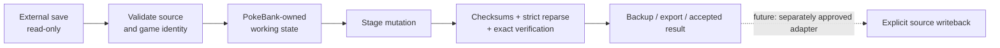

<p align="center">
  
</p>

<h1 align="center">PokeBank NX</h1>

<p align="center">
  <strong>A native, offline Pokémon bank and save-management frontend for CFW Nintendo Switch systems.</strong>
</p>

<p align="center">
  Browse supported saves, inspect Trainers / Party / Boxes / inventory, stage generation-aware Pokémon edits,
  and move toward one safe library for Pokémon across generations.
</p>

<p align="center">
  <a href="LICENSE"></a>
  
  
  
  
</p>

<p align="center">
  <a href="https://github.com/GlitchedZeus/PokeBank-NX/actions/workflows/host-tests.yml"></a>
  <a href="https://github.com/GlitchedZeus/PokeBank-NX/pull/307"></a>
  <a href="https://github.com/GlitchedZeus/PokeBank-NX/pull/314"></a>
</p>

<p align="center">
  <a href="#overview">Overview</a> •
  <a href="#project-status">Status</a> •
  <a href="#features">Features</a> •
  <a href="#supported-games">Games</a> •
  <a href="#save-safety">Safety</a> •
  <a href="#building">Build</a> •
  <a href="#roadmap">Roadmap</a> •
  <a href="#license">License</a>
</p>

---

> [!IMPORTANT]
> **Active alpha — no v1.0 release or complete Gen I–V hardware acceptance yet.** The owner verified the SHA-256 of [Round 5 NRO `1ca2faec`](https://github.com/GlitchedZeus/PokeBank-NX/actions/runs/40151550783/artifacts/12582906901) and tested it on a Switch on **October 25, 2026: 31 PASS / 8 FAIL / 3 NOT TESTED** across 42 targeted checks. The [complete owner findings](https://github.com/GlitchedZeus/PokeBank-NX/blob/claude/gen5-integration-20261014/docs/hardware/ROUND5_RESULTS_1ca2faec.md) include additional repair requests *under PASS items*. Claude is working on Round 6 in draft [application PR #307](https://github.com/GlitchedZeus/PokeBank-NX/pull/307); Codex is independently working on draft [legality PR #314](https://github.com/GlitchedZeus/PokeBank-NX/pull/314). Neither is merged into `main`. Only the full [20-game, every-action, exact-NRO acceptance gate #313](https://github.com/GlitchedZeus/PokeBank-NX/issues/313) can close the Gen I–V milestone. Gen VI–IX application integration waits for the owner's approval.


## Overview

PokeBank NX brings Pokémon save management to the Nintendo Switch with a consistent interface for older generations. Choose a game, find its save, browse the Trainer, Party, Boxes and inventory, and make changes in a staged workspace rather than editing the original file in place.

The project started with the classic Game Sources workflow and has grown into a HOME-inspired frontend with game artwork, trainer context, Party previews, source assignment and a shared editor. Underneath that interface, each generation keeps its own save structure, limits and history. A Gen I Pokémon should feel like a Gen I Pokémon—not a modern record with invented fields.

Current work centers on **finishing and hardware-accepting the combined Gen I–V application** across all 20 releases, with Claude repairing the shared editor and save-source workflows in [PR #307](https://github.com/GlitchedZeus/PokeBank-NX/pull/307) and Codex advancing the **separate, read-only Gen I–V legality engine** in [PR #314](https://github.com/GlitchedZeus/PokeBank-NX/pull/314). Master Vault/named Banks, later-generation emulator integration and direct original-save writeback remain future milestones.

### Design goals

- **Built for the Switch** — readable handheld UI, controller and touch interaction, useful game artwork and quick access to saves.
- **Respect the games** — generation-specific values, move restrictions and source rules, without silent conversions.
- **Keep saves safe** — external sources stay untouched during normal browsing and staged editing.
- **Make uncertainty visible** — a missing source, uncertain history or unsupported rule is reported, not guessed.
- **Prove each build** — passing automation matters, but a hardware claim belongs to the exact NRO that was tested.

## Project status

**Checked against live GitHub October 25, 2026.** ✅ implemented/previously owner-observed behavior; 🧪 active unmerged development or device retest; 🔬 research; ⏳ planned. A ✅ on a component is **not** approval of the entire generation or a v1.0 release.

| Area | Current implementation / development | Remaining |
|---|---|---|
| Native Switch application | ✅ C++20/devkitA64/libnx frontend, generation-aware shared Gen I–V editor, native NRO/RomFS and host/sanitizer/QA infrastructure; current repairs in [#307](https://github.com/GlitchedZeus/PokeBank-NX/pull/307) | Complete Round 6 repairs, source/launch/emulator acceptance, every-action 20-game gate and explicit owner sign-off |
| Gen I — Red/Blue/Yellow | ✅ Shared Party/Boxes/Trainer/Bag and staged Pokémon editing; prior targeted Switch passes | Review discoverability, consistent Trainer/Help/footers and full three-game acceptance |
| Gen II — Gold/Silver/Crystal | ✅ Native DVs/Stat Exp, calculated Special stats, box movement, OT Gender and staged editing; targeted Switch passes | Fix Gold/Silver Trainer overlap, polish Special layout and Unown form/shiny explanation; full acceptance |
| Gen III — R/S/E/FR/LG | ✅ Shared editor, Create with Safari **caught Ball**, staged Trainer/Bag, move/item search; targeted Switch passes | Repair Pokérus and Held Item selection, detailed Create Review, safe item restrictions and five-game acceptance |
| Gen IV — D/P/Pt/HG/SS | ✅ Shared staged editor, native Trainer/Bag support and moves/layout in [#307](https://github.com/GlitchedZeus/PokeBank-NX/pull/307); targeted Switch passes | Shared Trainer facelift/Review controls, provider export and launch/reopen proof, five-game acceptance |
| Gen V — B/W/B2/W2 | ✅ Shared PK5 Create/Edit, Party/Boxes/Trainer, native Bag, source assignment, species/form move filtering and inline Language in draft [#307](https://github.com/GlitchedZeus/PokeBank-NX/pull/307); targeted Switch passes | Fix Pokérus and display inconsistencies, Review discoverability, event labels and full four-game acceptance |
| Home, Game Browser and backups | ✅ Assigned-save opening, profile/source identity, full-screen immutable backup history and selected-copy staging were among Round 5 passing checks | Finish colored glyphs/Help/Party footer, touch parity and source/provider/launch acceptance |
| Combined Gen I–V NRO | 🧪 [Audited `1ca2faec` Round 5 build](https://github.com/GlitchedZeus/PokeBank-NX/actions/runs/40151550783/artifacts/12582906901): **31 PASS / 8 FAIL / 3 NOT TESTED** on Switch; [owner report](https://github.com/GlitchedZeus/PokeBank-NX/blob/claude/gen5-integration-20261014/docs/hardware/ROUND5_RESULTS_1ca2faec.md) | Round 6 code/build/retest and [all-action hardware acceptance #313](https://github.com/GlitchedZeus/PokeBank-NX/issues/313); S06 real-emulator export round-trip deferred |
| Gen I–V read-only legality | 🧪 Separate [#314](https://github.com/GlitchedZeus/PokeBank-NX/pull/314) with original-source/PKHeX-differential and native/sanitizer gates; last visible head `0b01ad6c` has successful check runs | Codex's current work, unresolved historical provenance, integration review and owner-approved application wiring; no universal legality certificate |
| Independent QA | ✅ Audited `1ca2faec` native artifact, host/export/touch contracts and cross-generation tests; the legality head has independent passing checks | Freeze and audit one *new* post-repair build; automated green never substitutes for Switch acceptance |
| Gen VI–VIII native formats | 🔬 Separate [#309](https://github.com/GlitchedZeus/PokeBank-NX/pull/309), [#311](https://github.com/GlitchedZeus/PokeBank-NX/pull/311), [#312](https://github.com/GlitchedZeus/PokeBank-NX/pull/312) research/draft work | Application integration waits for Gen I–V owner approval; Gen IX and remaining modern releases are planned |
| Vault/Banks, broad transfers, v1.0 | ⏳ [Future backlog](docs/FUTURE_AFTER_GEN15_BACKLOG.md), [roadmap #29](https://github.com/GlitchedZeus/PokeBank-NX/issues/29) | Persistent PokeBank-owned storage, supported Gen VI–IX application paths, legality/safety/UX release gates and full v1.0 acceptance |

> [!NOTE]
> **Exact device-test baseline:** `PokeBank-NX-Gen1-5-Candidate-1ca2faec.nro` (source `1ca2faec55ee64702eac6e0779daed3a1c8b3377`, SHA-256 `b8966cdbd108530ae1c056a07e318d2f05d0cdee30d910b361ab29f381e41511`). [Official artifact](https://github.com/GlitchedZeus/PokeBank-NX/actions/runs/40151550783/artifacts/12582906901) · [independent audit](https://github.com/GlitchedZeus/PokeBank-NX/actions/runs/40152597969) · [owner's 42 results](https://github.com/GlitchedZeus/PokeBank-NX/blob/claude/gen5-integration-20261014/docs/hardware/ROUND5_RESULTS_1ca2faec.md). Eight reported failures concern Pokérus/item activation, classic Trainer overlap, Review visibility, Help/glyphs, event labels and Unown UX; three checks remain untested. Newer app commits and green CI are **not** this accepted hardware build, and this build itself **did not pass full Gen I–V acceptance**.

## Features

### Product Home

The main screen is built around the game you're using. Trainer details, the current Party, Pokédex progress and the selected save sit alongside clear **Open** and **Launch** actions.

- Game and region artwork, trainer portraits and a six-Pokémon Party preview.
- Full Games artwork browser plus a quicker Games drawer.
- Game/save/profile assignment instead of treating every similarly named file as the same source.
- Real per-save Pokédex progress where available.
- Games, Banks, Items, Search and More navigation; planned destinations are marked as such.
- Settings and profiles kept out of the main card layout.
- Shared in-app keyboard and numpad, controller navigation and focus memory.
- Sorting, Release Date ordering, Favorites and multiple visual themes.

The integrated Product Home and legacy launch paths have an owner-tested checkpoint. Later UI refinements are still under review; the layout shown in a draft branch may not match the last accepted NRO.

### Games and save sources

The Games screen is also where a save gets assigned to its game. You can inspect supported source options, reassign a validated legacy save, and see when PokeBank NX cannot determine a unique match.

Source identity remains separate from launch identity. For example, a FireRed HOME forwarder can be a launch target without becoming the source of the GBA battery save. Ambiguous game versions, duplicate save paths and unverified ROM locations are not silently resolved.

### Pokémon and inventory

One **generation-aware shared Pokémon editor** serves Generations I–V. It respects native fields and holds changes in an app-owned staged workspace rather than mutating emulator sources.

- **Gen I–III:** staged Party/Boxes/Trainer/Items and View/Create/Edit, including native DV/Stat Exp/ability rules where applicable; Gen III Safari Ball **caught Ball** creation is owner-tested.
- **Gen IV:** native shared Party/Boxes/Create/Edit, Trainer/badges/Bag, item and move details; staged exports and provider support on [#307](https://github.com/GlitchedZeus/PokeBank-NX/pull/307).
- **Gen V:** Black/White/Black 2/White 2 native PK5, Trainer/Party/24 Boxes, Create/Clone/Move, Bag, selected save sources, staged Review and verified **Export Copy**; direct move pools and inline Language passed the Round 5 targeted retest.
- **Cross-generation Review and backups:** shared staged-exit choices, backup history and isolated selected-copy opening have working owner-tested paths, while discoverable in-screen Review, Help, layout and touch parity still need Round 6 fixes.
- **Current Round 6 repairs:** Gen III/V Pokérus and Held Item input, Gold/Silver Trainer overlap, shared Gen V-style Trainer screens, visible Bag/Create/Party Review, colored controls and event-location disambiguation ([owner hardware report](https://github.com/GlitchedZeus/PokeBank-NX/blob/claude/gen5-integration-20261014/docs/hardware/ROUND5_RESULTS_1ca2faec.md)).
- **Native restrictions:** Gen III Safari Ball and Berry Juice are restricted as **new held items** following the owner's decision; a Safari Ball can still be a valid **caught Ball**. Existing unusual data is preserved without silently normalizing it.
- **Profiles and save identity:** exact source/provider assignments, validated Primary/Backup choices and explicit paths for RetroArch, DraStic, melonDS and manual sources. No blanket source mutation or writeback permission.

Earlier application PRs [#278](https://github.com/GlitchedZeus/PokeBank-NX/pull/278), [#300](https://github.com/GlitchedZeus/PokeBank-NX/pull/300), [#304](https://github.com/GlitchedZeus/PokeBank-NX/pull/304) and [#306](https://github.com/GlitchedZeus/PokeBank-NX/pull/306) were closed as **superseded** after their heads were verified inside #307. Their commits were preserved; this did **not** merge them into `main` or authorize hardware acceptance.

## Supported games

| Generation | Games | Save/source | Shared staged editor | Hardware |
|---|---|:---:|:---:|---|
| I | Red / Blue / Yellow | ✅ | ✅ | Targeted passes; full gate open |
| II | Gold / Silver / Crystal | ✅ | ✅ | Targeted passes; Round 6 fixes pending |
| III | Ruby / Sapphire / Emerald / FireRed / LeafGreen | ✅ | ✅ | Targeted passes; Round 6 fixes pending |
| IV | Diamond / Pearl / Platinum / HeartGold / SoulSilver | ✅ | ✅ | Targeted passes; full gate open |
| V | Black / White / Black 2 / White 2 | 🧪 | 🧪 integrated draft | Targeted passes; full gate open |
| VI | X / Y / Omega Ruby / Alpha Sapphire | 🔬 | 🔬 standalone backend only | On hold for app integration |
| VII | Sun / Moon / Ultra Sun / Ultra Moon | 🔬 | ❌ integrated editor | On hold; SAV7 groundwork |
| VIII | Sword / Shield | 🔬 | ❌ integrated editor | On hold; PK8 groundwork |
| Later modern Switch / IX | LGPE, BDSP, PLA, Scarlet/Violet, Legends: Z-A | ⏳ | ❌ general editor | Future |

All **20 Gen I–V game releases** need their own hardware smoke and applicable every-action coverage under [#313](https://github.com/GlitchedZeus/PokeBank-NX/issues/313). The **31/8/3 Round 5 targeted result** is progress evidence, not universal 20-game sign-off. Later-generation native-format research is not a finished Switch application.

## Save sources and launching

PokeBank NX treats each discovered save as a **game + provider + source identity**. A title can have more than one candidate save, and a save's location is not proof of where its ROM or forwarder lives.

The current implementation includes:

- RetroArch legacy source discovery and tested GB/GBC/GBA launch paths.
- DraStic and melonDS Gen IV source support, with provider-neutral assignment.
- Gen V RetroArch/DraStic/melonDS/manual **Save Instances**, exact BW/B2W2 matching, explicit Primary/Backup choice, **Assign Save to This Profile** and strict reopen fingerprint checks ([#307](https://github.com/GlitchedZeus/PokeBank-NX/pull/307)); full device acceptance remains pending.
- Full-screen backup history with readable timestamps and isolated opening of the **selected** emulator backup passed the Round 5 targeted Switch check; original and historical source copies remain protected, and exports use a new destination.
- Manual and remembered source selection, duplicate detection, explicit source details and real provider labels; assigned-save Home snapshots are revalidated when source metadata changes.
- Game-file links, bounded content discovery and exact-release matching for launch targets.
- Matching installed HOME-forwarder launch preference where the title is proven.
- A safe **Link Game File** fallback when the launch target cannot be identified.

The tested `0760334f` NRO includes working legacy RetroArch launches, Nintendo DS direct launch (Diamond was tested) and owner-confirmed **Quit & Return**. An experimental nested Return Host caused regressions and was excluded from that accepted route.

Gen I–III provider-specific bounded discovery already has mGBA and Tico groundwork in its development lineage. Cross-generation provider completeness and Switch acceptance vary; generalized 3DS and additional emulator adapters remain roadmap work.

> [!WARNING]
> A save path is **not** a ROM path. Launch access never grants write access to that save, and the app should ask for a source or game-file link rather than guess.

## Save safety

The save-safety contract is intentionally boring — and that is the point.



### Permanent guardrails

- ✅ Original external saves remain immutable during ordinary editing.
- ✅ Emulator-source writes remain disabled.
- ✅ Installed-title live writes remain disabled.
- ✅ Unknown or ambiguous sources fail closed.
- ✅ App-owned staged editing is allowed.
- ✅ Destructive operations require explicit intent.
- ✅ Launch capability and write capability are separate permissions.
- ❌ No global unsafe-write toggle.
- ❌ Source injection is not enabled as a side effect of editor work.
- ❌ Cross-game True Move is not broadly enabled.

The intended future transaction model is:

**fingerprint → backup → stage → validate → explicit write → readback → recovery/rollback**

Every source adapter must earn write permission independently.

## Read-only legality engine

**Active Gen I–V legality campaign: [PR #314](https://github.com/GlitchedZeus/PokeBank-NX/pull/314)**, being developed separately from Claude's application branch. Its latest visible commit at this check is `0b01ad6c614c1652a6c9591195ebff22cb761d8f` (October 21); the visible exact-head legality checks passed, but newer work may not have been pushed. The draft contains Gen I–V native/source-backed analysis and PKHeX differential tests; **reviewed integration into the current app is still pending**. Original distribution, transfers and GameCube provenance remain incomplete in places; complete PKHeX parity is **not** claimed.

The native [Gen I–IV read-only foundation #103](https://github.com/GlitchedZeus/PokeBank-NX/pull/103) and the five specialist lanes feed the integrated PK1–PK5 campaign. Its differential results are **test-corpus measurements**, not a universal percent of all historical Pokémon: Gen III catches 43,110/43,120 invalid mutations (99.98%); Gen IV 83,599/83,599 base and 113,993/113,993 grown (100% of those corpora); Gen V 231,941/233,840 (99.2%). No false Valid/Invalid errors were reported under the published corpus criteria. Colosseum/XD transfer provenance, selected Gen II Korean/history cases and other missing evidence remain **Incomplete**. [Rule coverage and production wiring](https://github.com/GlitchedZeus/PokeBank-NX/blob/claude/gen1-5-legality-campaign-w9mkom/docs/legality/GEN1_5_RULE_COVERAGE.md). The specialist lanes are:

| Area | Specialist lane | Evidence |
|---|---|---|
| Encounters / RNG | [L1 #293](https://github.com/GlitchedZeus/PokeBank-NX/pull/293) | Original wild, fishing, static, game-specific encounter slots and RNG histories |
| Breeding / eggs | [L2 #295](https://github.com/GlitchedZeus/PokeBank-NX/pull/295) | Egg, inherited move/IV and native PID chronology |
| Moves / transfers | [L3 #296](https://github.com/GlitchedZeus/PokeBank-NX/pull/296) | Joint four-move histories, TM/HM, Time Capsule and Pal Park |
| Events / native metadata | [L4 #292](https://github.com/GlitchedZeus/PokeBank-NX/pull/292) | Authenticated original distribution, event context, Balls/ribbons/Trainer data |
| Research and QA | [L5 #294](https://github.com/GlitchedZeus/PokeBank-NX/pull/294) | Pinned originals, independent positive/negative/Unknown tests, PKHeX differentials |

| Result | Meaning |
|---|---|
| **Invalid** | Source-backed applicable evidence establishes a contradiction |
| **No problems found** | The implemented checks found no issue; not a global legality certificate |
| **Incomplete / Unknown** | Missing original history, unsupported mechanics or insufficient evidence |

The important distinction is between a **possible candidate history** and proof of an actual trainer's encounter, trade, TM use or event. Gen I has no native abilities, natures, gender or breeding fields; unsupported history must never be invented to complete a report.

> [!CAUTION]
> Legality analysis remains strictly **read-only**. It does not fix Pokémon, mutate external source saves, enable cross-game True Move, or certify unverified original distributions. The final Gen I–V legality scope must be backed by source evidence, passing exact-head tests and independently reviewed Unknown handling.

[Current legality campaign #314](https://github.com/GlitchedZeus/PokeBank-NX/pull/314) · [original Gen I acceptance ledger](docs/legality/GEN1_RBY_ACCEPTANCE_LEDGER_20261013.md) · [later-format foundation #301](https://github.com/GlitchedZeus/PokeBank-NX/pull/301).

## Engineering quality

PokeBank NX is checked at more than one level:

- Host regressions covering save parsing, editor rules, UI contracts and source custody.
- ASan/UBSan runs and malformed-save quarantine tests.
- Generated data, art/asset and native packaging checks.
- Clean devkitA64/libnx builds and NRO artifacts for exact commits.
- Focused Gen I–IV editor, source-opening, move and save-recovery tests.
- Physical Switch testing against an exact NRO, not just a passing branch.

The full repository forensic audit was completed, and the remediation was integrated into the active application branch in [PR #101](https://github.com/GlitchedZeus/PokeBank-NX/pull/101): **43 verified/fixed findings, one explicitly deferred, none left open in that audit ledger**. The deferred trainer-name presentation case still needs a real failing disposable Gen IV save; it is not being hidden by fabricating a name.

The separate legality campaign runs dedicated PKHeX differential, native, sanitizer, original-source and cross-lane gates; the last visible #314 head has successful checks. The audited Round 5 application NRO was owner-tested at **31 PASS / 8 FAIL / 3 NOT TESTED**. Neither set of automated checks replaces exact-build Switch validation or proves universal historical legality.

<details>
<summary><strong>Active engineering branches and checkpoints</strong></summary>

| Branch / PR | Current purpose and gate |
|---|---|
| [#307 — combined Gen I–V app](https://github.com/GlitchedZeus/PokeBank-NX/pull/307) | Draft; Round 6 repairs underway after `1ca2faec` Switch results **31/8/3**; full [#313](https://github.com/GlitchedZeus/PokeBank-NX/issues/313) owner sign-off OPEN |
| [#314 — Gen I–V legality campaign](https://github.com/GlitchedZeus/PokeBank-NX/pull/314) | Draft; latest visible head `0b01ad6c`, independent legality checks green; reviewed app integration and provenance gaps remain |
| [#298/#303, L1–L5 — legality lineage](https://github.com/GlitchedZeus/PokeBank-NX/issues/285) | Historical source/research/test evidence must remain until integrated or explicitly archived with proof |
| [#309/#311/#312 — future generations](https://github.com/GlitchedZeus/PokeBank-NX/pull/309) | Gen VI–VIII native research only; app integration paused until Gen I–V approval |
| [#278/#300/#304/#306 — earlier app PRs](docs/GITHUB_CLEANUP_20261015.md) | Closed as superseded by #307; unique history retained, not merged to `main` |

**Target after accepted integration:** `main` (owner-approved application), `development/gen6-plus` (future-generation app) and `development/legality-engine` (evidence-backed legality), plus small temporary PR branches. On **October 25, 2026**, GitHub lists **295 branch refs and 29 open PRs**. This is a cleanup *inventory*, not authorization to delete any branch: preserve unique commits, source evidence, hardware artifacts and active Claude/Codex work first. See the [three-branch plan](docs/THREE_BRANCH_CONSOLIDATION_PLAN.md).

</details>

## Building

PokeBank NX targets Nintendo Switch homebrew using **C++20**, **devkitPro / devkitA64 / libnx**, **SDL2** for platform/window/input support, and **NanoVG/OpenGL** for the current renderer.

### Requirements

- devkitPro;
- devkitA64;
- libnx;
- GNU Make;
- a CFW Nintendo Switch / homebrew environment for device testing.

The Makefile requires `DEVKITPRO` to be set in the environment.

```bash
git clone https://github.com/GlitchedZeus/PokeBank-NX.git
cd PokeBank-NX
make
```

The native target is `PokeBankNX.nro`.

> [!NOTE]
> There is no v1.0 release yet. For development/hardware candidates, GitHub Actions is the reproducible build path used by the project. Hardware acceptance is tied to the exact application commit and exact built NRO, not merely to a nearby green commit.

## Installation

For a locally built/development NRO:

1. Create a folder such as `sdmc:/switch/PokeBank-NX/`.
2. Copy `PokeBankNX.nro` into that folder.
3. Launch it from the Switch homebrew menu.
4. Keep your real saves backed up and treat development builds as development builds.

PokeBank NX does not provide commercial game ROMs or console firmware.

## Repository layout

| Path | Purpose |
|---|---|
| `src/` | Application, UI, save, Pokémon, conversion, legality and integration code |
| `include/` | Public/internal interfaces and shared models |
| `romfs/` | Runtime presentation/data assets packaged into the NRO |
| `assets/` | Application metadata/icon resources |
| `tests/` | Host regression and safety-contract tests |
| `tools/` | Data generation, asset preparation and maintenance utilities |
| `.github/workflows/` | Host, sanitizer and native Switch CI |
| `docs/` | Engineering status, support matrices, architecture and roadmap documentation |

## Roadmap

**Finish Gen I–V first → owner accepts one exact all-20-game NRO → reviewed legality integration and safe branch consolidation → Gen VI–IX application development → complete v1.0 safety, storage, UI and legality gates.** These workstreams can be researched in parallel, but an unaccepted draft is not a release.

1. **Round 6 application repairs:** Claude addresses the owner's [eight Round 5 hardware failures and PASS-with-comment follow-ups](https://github.com/GlitchedZeus/PokeBank-NX/blob/claude/gen5-integration-20261014/docs/hardware/ROUND5_RESULTS_1ca2faec.md) on [#307](https://github.com/GlitchedZeus/PokeBank-NX/pull/307), preserving all **31 previous passes** and the owner's Gen III held-item decision.
2. **Independent legality completion:** Codex continues [#314](https://github.com/GlitchedZeus/PokeBank-NX/pull/314), retaining original-source, differential and Unknown/Incomplete evidence gates. Keep its work separate until an explicitly reviewed integration.
3. **One new exact NRO and real hardware retest:** GCC/Clang, sanitizers, fuzz, native/RomFS, backup custody, exact-byte artifact audit and staged exports. The owner tests repaired paths on Switch; no CI result becomes a hardware PASS.
4. **Full Gen I–V acceptance:** enumerate every reachable action across [all 20 releases, controllers/touch, sources/providers, Review, backups, launch/return and emulator export round-trips](docs/handoffs/GEN15_HARDWARE_ACCEPTANCE_GATE_20261015.md). Close [#313](https://github.com/GlitchedZeus/PokeBank-NX/issues/313) **only after explicit owner acceptance of the exact NRO**.
5. **Integrate and consolidate responsibly:** review accepted app and legality histories; merge only with owner approval, tag/archive irreplaceable evidence and binaries, then verify branch ancestry and safely retire **superseded** PRs, issues and branch refs. Never delete active Claude/Codex branches or unmerged unique work just to reduce the count.
6. **Build out Gen VI–IX and v1.0:** reuse the shared product/editor architecture for 3DS and later Switch titles, add supported emulator adapters and durable Vault/Banks/transfer features, and meet full touch-only, save-recovery, licensing, legality and release-validation requirements before declaring **1.0**.

[Acceptance issue #313](https://github.com/GlitchedZeus/PokeBank-NX/issues/313) · [release roadmap #29](https://github.com/GlitchedZeus/PokeBank-NX/issues/29) · [three-branch consolidation plan](docs/THREE_BRANCH_CONSOLIDATION_PLAN.md) · [future backlog](docs/FUTURE_AFTER_GEN15_BACKLOG.md).

## Bug reports

Useful hardware reports include:

- Exact tested NRO/version and code SHA (latest owner test: `1ca2faec`, October 25, **31 PASS / 8 FAIL / 3 NOT TESTED** across 42 targeted checks);
- exact NRO hash when available;
- Switch mode (handheld/docked);
- game and generation;
- source/provider (RetroArch, DraStic, melonDS, manual, etc.);
- exact steps to reproduce;
- screenshots or video when the issue is visual.

Please avoid posting personal/private save files publicly. Use a disposable test save when a reproduction requires writable or sensitive data.

## Project documentation

- [**Complete Gen I–V hardware acceptance matrix**](docs/handoffs/GEN15_HARDWARE_ACCEPTANCE_GATE_20261015.md) — 106 starter checks expanded to every action across all 20 releases.
- [**Latest owner Switch results: Round 5, 31 PASS / 8 FAIL / 3 NOT TESTED**](https://github.com/GlitchedZeus/PokeBank-NX/blob/claude/gen5-integration-20261014/docs/hardware/ROUND5_RESULTS_1ca2faec.md) — all comments and Round 6 repair priorities.
- [**Audited Round 5 retest checklist and artifact identity**](https://github.com/GlitchedZeus/PokeBank-NX/blob/claude/gen5-integration-20261014/docs/hardware/RETEST_1ca2faec.md) — exact NRO, SHA-256, audit and on-device paths.
- [**Three-branch consolidation plan**](docs/THREE_BRANCH_CONSOLIDATION_PLAN.md) — target `main`, future Gen VI+ and legality lines; archive/ancestry proof before branch pruning.
- [Current Engineering Status](CURRENT_STATUS.md), [Project Status](PROJECT_STATUS.md) and [Build / NRO Artifact Record](docs/BUILD_RECORD.md).
- [Game Support Matrix](docs/GAME_SUPPORT_MATRIX.md), [v1.0 Roadmap](docs/V1_ROADMAP.md) and [UI Ownership](docs/UI_OWNERSHIP_STATUS.md).
- [Gen I–V app #307](https://github.com/GlitchedZeus/PokeBank-NX/pull/307), [legality integration #314](https://github.com/GlitchedZeus/PokeBank-NX/pull/314), [hardware acceptance #313](https://github.com/GlitchedZeus/PokeBank-NX/issues/313) and [release gates #29](https://github.com/GlitchedZeus/PokeBank-NX/issues/29).
- [GitHub housekeeping record](docs/GITHUB_CLEANUP_20261015.md), [future ideas archive](docs/FUTURE_AFTER_GEN15_BACKLOG.md) and [October 14 cross-lane snapshot](docs/ENGINEERING_SNAPSHOT_20261014.md) (historical).

**GitHub is authoritative for live development; owner device acceptance belongs to the exact tested NRO.** A successful CI run or an older accepted binary cannot certify a newer build.

## License

PokeBank NX is licensed under the **GNU Affero General Public License v3.0 (AGPL-3.0)**.

> [!NOTE]
> The complete license terms are in [LICENSE](LICENSE). The README is not a substitute for the license text.

Third-party code, data, research, artwork sources, and reference projects retain their own licenses and attribution requirements.

## Disclaimer

PokeBank NX is an unofficial fan-made homebrew project and is not affiliated with or endorsed by Nintendo, The Pokémon Company, GAME FREAK, or Creatures Inc.

Pokémon and related trademarks and game assets are property of their respective owners.
