# PokeBank NX — Owner screenshot gallery

These are 18 actual Nintendo Switch screenshots supplied by the owner on November 2, 2026. Most show the Gen I–V Round 13 alpha (`9c301c48`). **15 PASS / 12 FAIL** on 27 owner checks; screenshots show the interface, not feature or release acceptance. See [project status](STATUS.md), [releases](RELEASES.md) and [original QA JSON](hardware/round13/OWNER_RESULTS_9c301c48.json).

Game artwork, Pokémon and trainer images belong to their rights holders.

[Back to README](../README.md#screenshots)

## Dashboard and game browser

| Blue dashboard | Ruby dashboard |
| --- | --- |
| 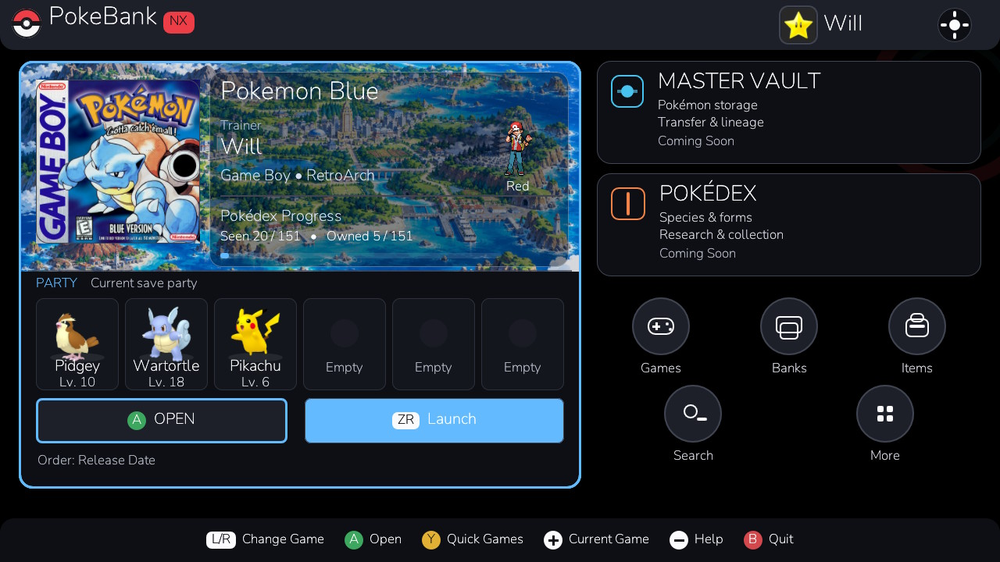 | 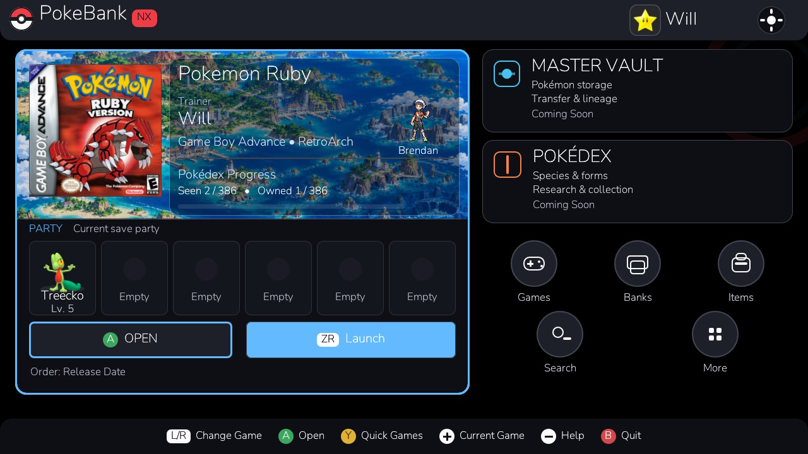 |

| Classic browser | DS and modern browser |
| --- | --- |
| 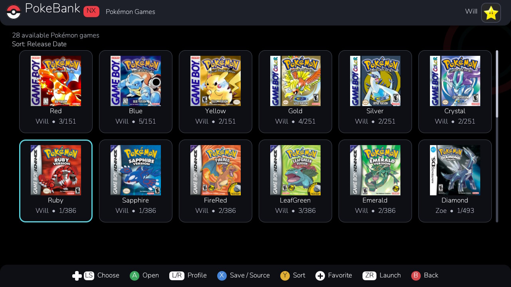 | 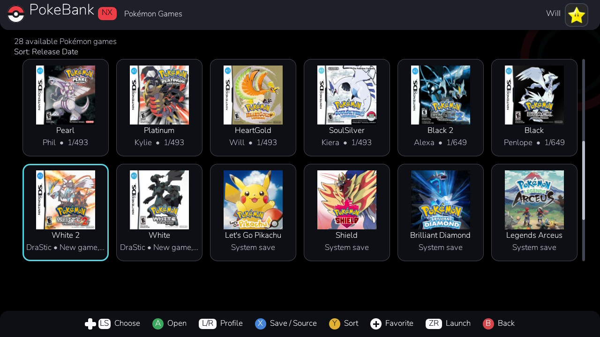 |

## Navigation

| Quick Games drawer | Black game workspace |
| --- | --- |
| 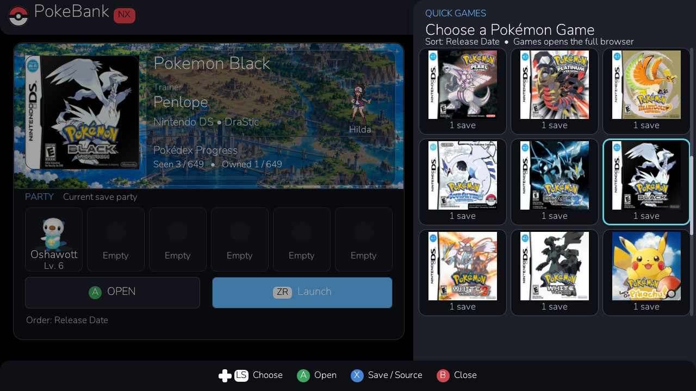 | 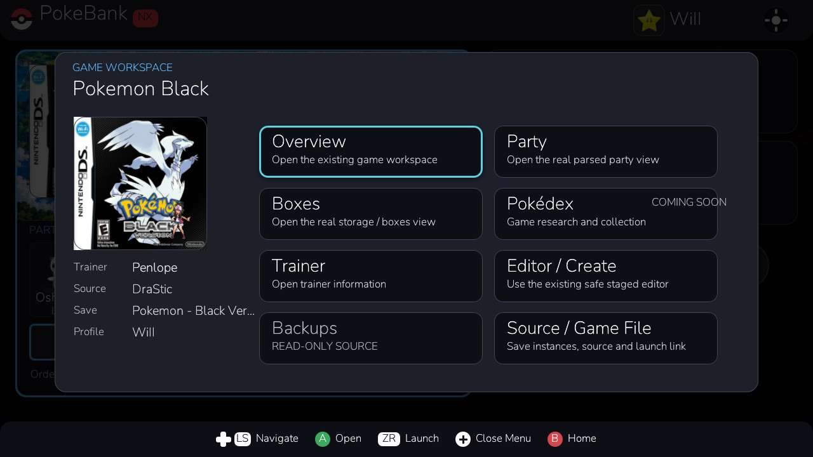 |

| Controls and Help |
| --- |
| 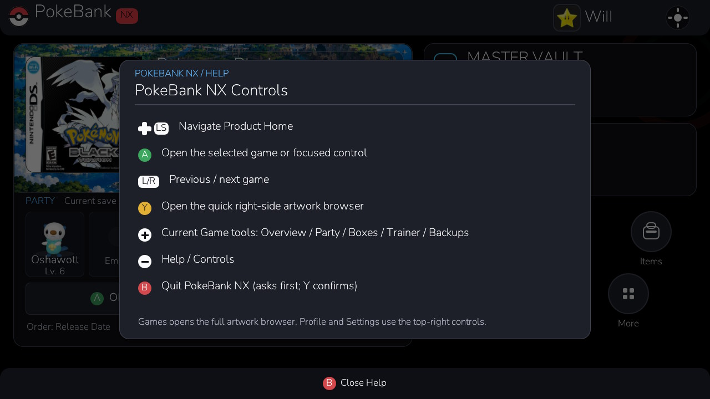 |

## Editor and pickers

| Pikachu editor | Species chooser |
| --- | --- |
| 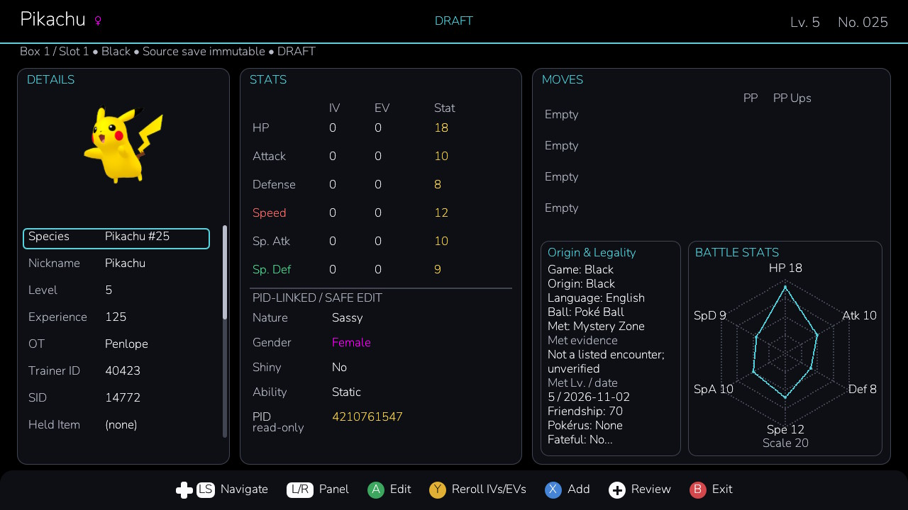 | 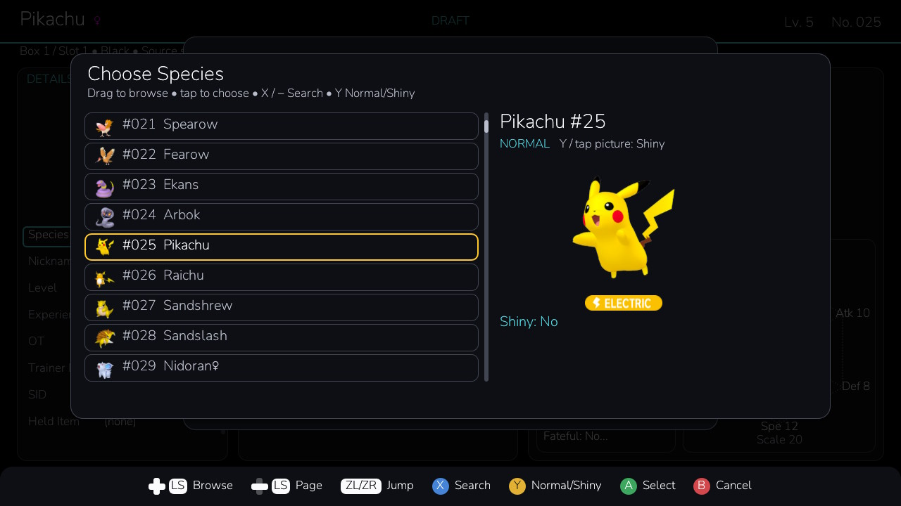 |

| Move chooser | Held item chooser |
| --- | --- |
| 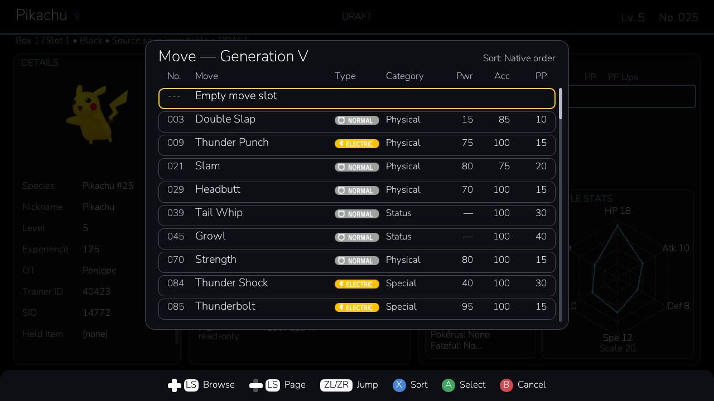 | 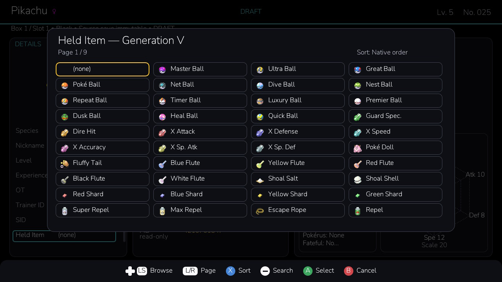 |

## Trainer Party and inventory

| Trainer editor | Party |
| --- | --- |
| 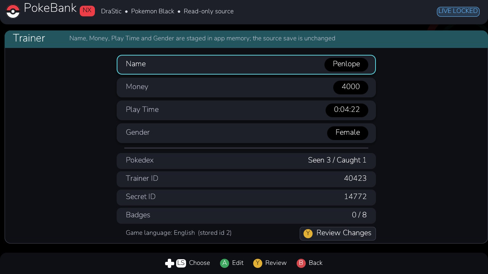 | 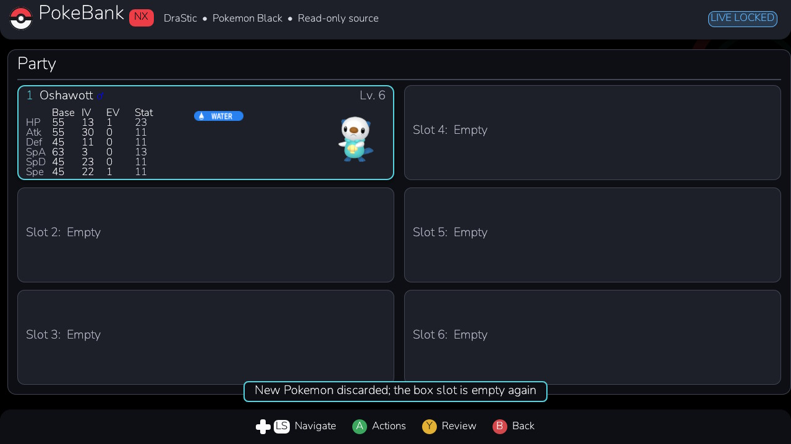 |

| Add Item | Empty item pocket |
| --- | --- |
| 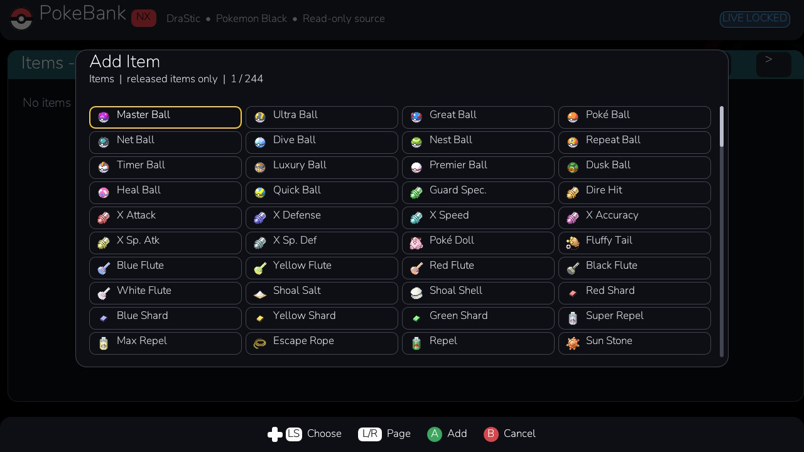 | 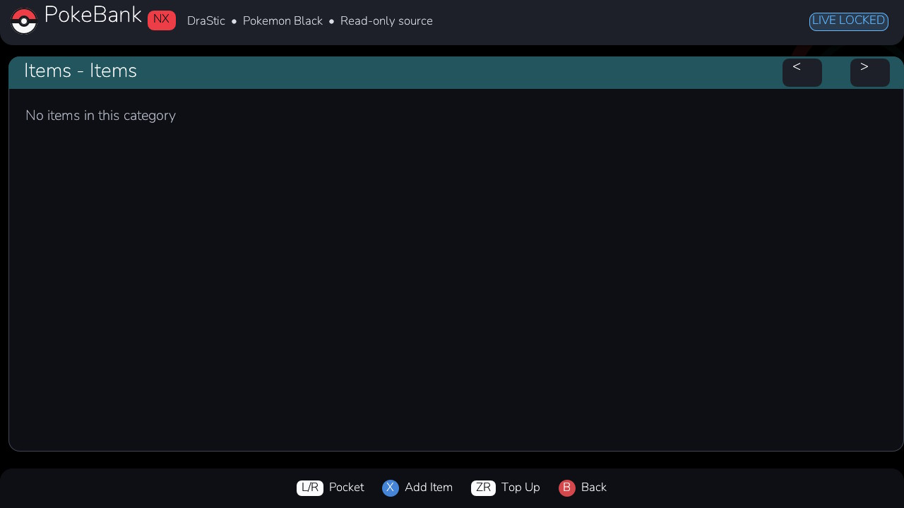 |

## Open save-assignment defect

| White 2 storage without save | White 2 box without save |
| --- | --- |
| 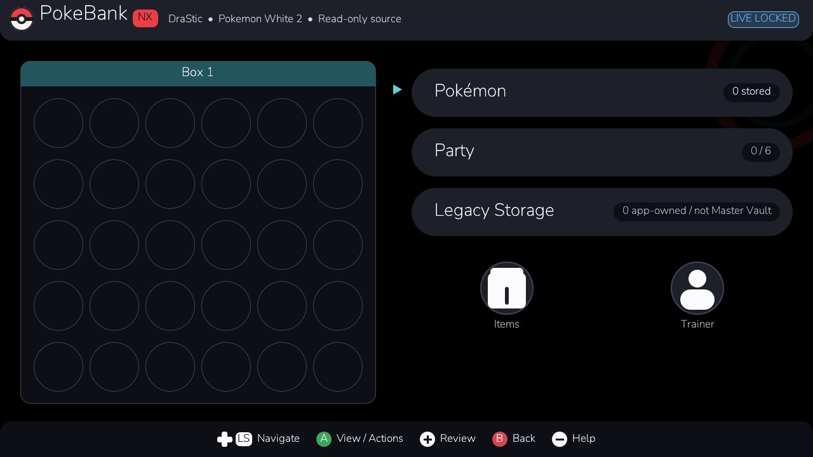 | 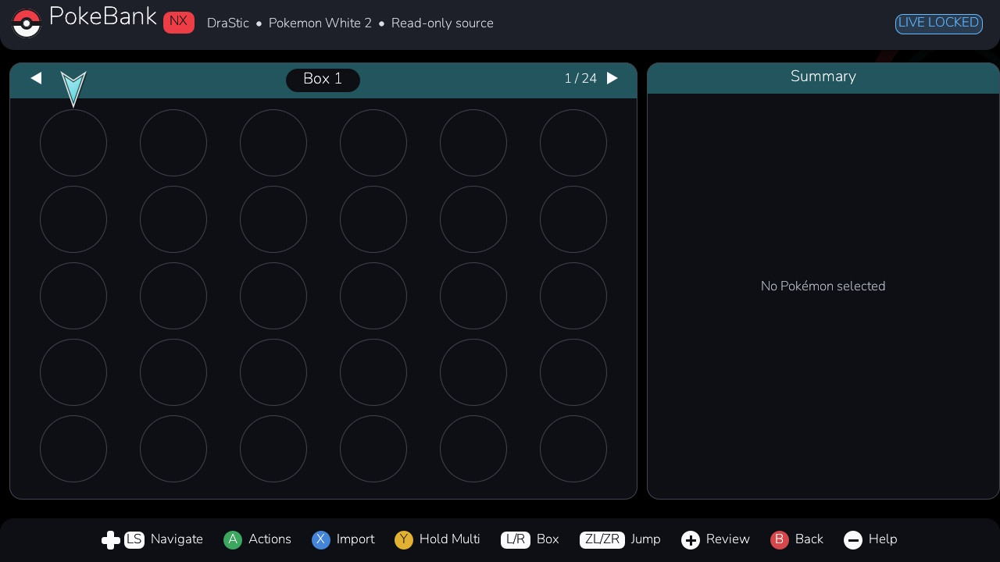 |

**Unresolved Round 13 bug:** White 2 editor/storage could be opened without an assigned valid save. These pictures document the failure, not accepted functionality.

## Experimental modern-generation preview

| Legends Z-A dashboard |
| --- |
| 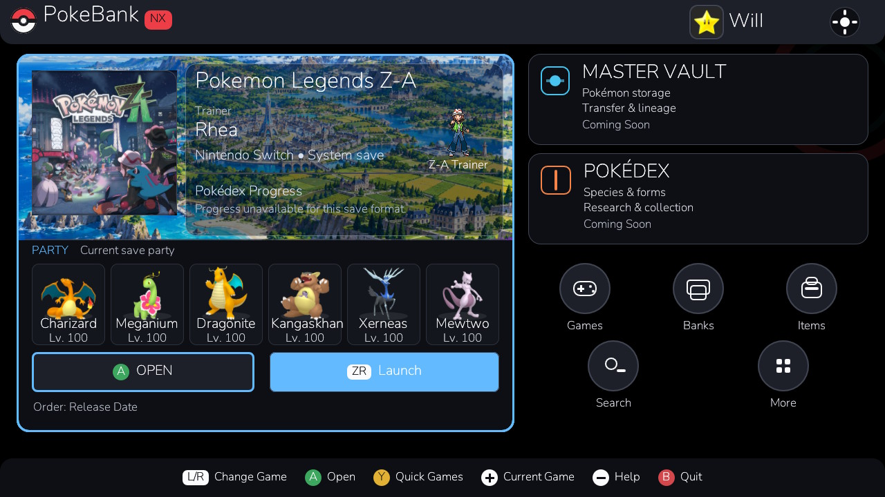 |

**Preview only:** Gen VI–IX work is paused after failed hardware retests. The Z-A dashboard does not establish Gen IX editing, native Trainer/Bag writers, or approval.

Original sources remain immutable and edits are staged. Master Vault, cross-generation transfer and persistent deposit/withdraw remain unimplemented.
